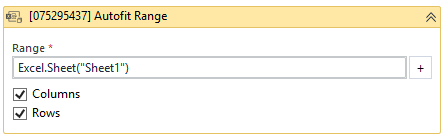
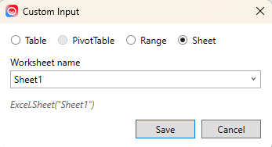

# Autofit Range

RCA.Activities.Excel.Modern.AutoFitX

## **Description**

This activity fits the width of the columns and/or the height of the rows to the data in a sheet, range or table.

At least one of **Columns** and **Rows** must be selected; otherwise the activity shows a validation error.

This activity must be placed inside a **Use Excel File** scope.

Click the **+** button next to **Range** to open the **Custom Input** dialog, which builds the reference for you.

(\* is mandatory)

## **In the body of the activity**

* **Range (ExcelRangeRef)**\* - The sheet, range or table to autofit. Use the **+** button to build the reference.  
  E.g: `Excel.Sheet("Sheet1")`
* **Columns (Checkbox)** - See Options.
* **Rows (Checkbox)** - See Options.

## **Properties**

**Input**

* **Range (ExcelRangeRef)**\* - The sheet, range or table to autofit.  
  E.g: `Excel.Range("Sheet1", "A1:D10")`

**Options**

* **Columns (Checkbox)** - When selected, autofit is applied to the columns of the range. By default, this check box is selected.
* **Rows (Checkbox)** - When selected, autofit is applied to the rows of the range. By default, this check box is selected.

**Misc**

* **Public (Checkbox)** - Check if you want to publicize it. Remember to consider data security requirements before using it.
* **Display Name (String)** - The name of this activity. You can edit the name of the activity to organize and structure your code better.  
  E.g: Autofit Range
