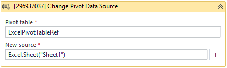

# Change Pivot Data Source

RCA.Activities.Excel.Modern.ChangePivotTableDataSourceX

## **Description**

This activity changes the source range of a pivot table.

This activity must be placed inside a **Use Excel File** scope.

(\* is mandatory)

## **In the body of the activity**

* **Pivot table (ExcelPivotTableRef)**\* - The pivot table to update. Use the variable that [Create Pivot Table](./create-pivot-table.md) saved.  
  E.g: salesPivot
* **New source (ExcelRangeRef)**\* - The new range to be used as the source of the pivot table. Use the **+** button to build the reference.  
  E.g: `Excel.Range("Data", "A1:F500")`

## **Properties**

**Input**

* **Pivot table (ExcelPivotTableRef)**\* - The original pivot table to be updated.  
  E.g: salesPivot
* **New source (ExcelRangeRef)**\* - The new range to be used as the source of the pivot table.  
  E.g: `Excel.Range("Data", "A1:F500")`

**Misc**

* **Public (Checkbox)** - Check if you want to publicize it. Remember to consider data security requirements before using it.
* **Display Name (String)** - The name of this activity. You can edit the name of the activity to organize and structure your code better.  
  E.g: Change Pivot Data Source
