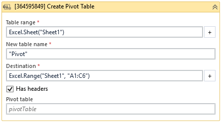

# Create Pivot Table

RCA.Activities.Excel.Modern.CreatePivotTableX

## **Description**

This activity creates a pivot table from a range or table, to help you calculate, summarize and analyze data. The new pivot table is also returned as a pivot table reference, which you pass to [Pivot Table Field](./pivot-table-field.md) to add fields, and to [Filter Pivot Table](./filter-pivot-table.md), [Refresh Pivot Table](./refresh-pivot-table.md) and [Change Pivot Data Source](./change-pivot-data-source.md).

The activity requires a name for the pivot table, otherwise it shows a validation error.

This activity must be placed inside a **Use Excel File** scope.

(\* is mandatory)

## **In the body of the activity**

* **Table range (ExcelRangeRef)**\* - The table or range to analyze with the pivot table. Use the **+** button to build the reference.  
  E.g: `Excel.Table("Data", "SalesTable")`
* **New table name (String)**\* - The name of the new pivot table.  
  E.g: "SalesPivot"
* **Destination (ExcelRangeRef)**\* - Where to place the new pivot table.  
  E.g: `Excel.Range("Pivot", "A3")`
* **Has headers (Checkbox)** - See Options.
* **Pivot table (ExcelPivotTableRef)** - The variable that receives the new pivot table.  
  E.g: salesPivot

## **Properties**

**Input**

* **Table range (ExcelRangeRef)**\* - The table or range to analyze with a pivot table.  
  E.g: `Excel.Table("Data", "SalesTable")`
* **New table name (String)**\* - The name of the new pivot table.  
  E.g: "SalesPivot"
* **Destination (ExcelRangeRef)**\* - Where to place the new pivot table.  
  E.g: `Excel.Range("Pivot", "A3")`

**Options**

* **Has headers (Checkbox)** - When selected, the first row of the table range is used as the header row, so its values are the field names. By default, this check box is selected.

**Output**

* **Pivot table (ExcelPivotTableRef)** - Saves the new pivot table for use in other activities.  
  E.g: salesPivot

**Misc**

* **Public (Checkbox)** - Check if you want to publicize it. Remember to consider data security requirements before using it.
* **Display Name (String)** - The name of this activity. You can edit the name of the activity to organize and structure your code better.  
  E.g: Create Pivot Table

## **Example: summarize sales by region**

The table *SalesTable* on the sheet *Data* has the columns **Region**, **Product** and **Amount**. This example builds a pivot table on the sheet *Pivot* that shows the total Amount for each Region. The sheet *Pivot* must already exist (see [Insert Sheet](./insert-sheet.md)).

1. Inside a **Use Excel File** scope, add **Create Pivot Table**:
   * **Table range**: `Excel.Table("Data", "SalesTable")`
   * **New table name**: `"SalesPivot"`
   * **Destination**: `Excel.Range("Pivot", "A3")`
   * **Pivot table**: a new variable `salesPivot`
2. Add a [Pivot Table Field](./pivot-table-field.md) activity:
   * **Pivot table**: `salesPivot`
   * **Field name**: `"Region"`
   * **Field type**: Row
3. Add a second **Pivot Table Field** activity:
   * **Pivot table**: `salesPivot`
   * **Field name**: `"Amount"`
   * **Field type**: Value
   * **Function**: Sum
4. Run the workflow. The pivot table lists each Region with the sum of its Amount.

Later, when the data in *SalesTable* changes, use [Refresh Pivot Table](./refresh-pivot-table.md) with `salesPivot` to update it, or [Filter Pivot Table](./filter-pivot-table.md) to show only some regions.
