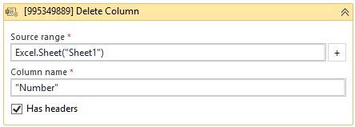

# Delete Column

RCA.Activities.Excel.Modern.DeleteColumnX

## **Description**

This activity deletes one column from a sheet, table or range.

This activity must be placed inside a **Use Excel File** scope.

(\* is mandatory)

## **In the body of the activity**

* **Source range (ExcelRangeRef)**\* - The sheet, table or range from which to delete a column. Use the **+** button to build the reference.  
  E.g: `Excel.Table("Sheet1", "Table1")`
* **Column name (String)**\* - The column to delete: a header name, a column letter, or a position in the range.  
  E.g: "Status", "C" or "3"
* **Has headers (Checkbox)** - See Options.

## **Properties**

**Input**

* **Source range (ExcelRangeRef)**\* - The range from which to delete a column.  
  E.g: `Excel.Table("Sheet1", "Table1")`
* **Column name (String)**\* - The column to delete: a header name, a column letter, or a position in the range.  
  E.g: "Status"

**Options**

* **Has headers (Checkbox)** - When selected, the first row in the range is a header row. By default, this check box is selected.

**Misc**

* **Public (Checkbox)** - Check if you want to publicize it. Remember to consider data security requirements before using it.
* **Display Name (String)** - The name of this activity. You can edit the name of the activity to organize and structure your code better.  
  E.g: Delete Column
