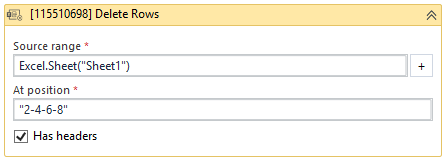

# Delete Rows

RCA.Activities.Excel.Modern.DeleteRowsX

## **Description**

This activity deletes the specified rows from a sheet, table or range. The row numbers are counted from the first row of the source, not from the first row of the worksheet.

This activity must be placed inside a **Use Excel File** scope.

(\* is mandatory)

## **In the body of the activity**

* **Source range (ExcelRangeRef)**\* - The sheet, range or table from which to delete rows. Use the **+** button to build the reference.  
  E.g: `Excel.Table("Sheet1", "Table1")`
* **At position (String)**\* - The rows to delete: numbers or ranges of numbers, separated by commas.  
  E.g: "3, 5-7, 10"
* **Has headers (Checkbox)** - See Options.

## **Properties**

**Input**

* **Source range (ExcelRangeRef)**\* - The sheet, range or table from which to delete rows.  
  E.g: `Excel.Table("Sheet1", "Table1")`
* **At position (String)**\* - The rows to delete: numbers or ranges of numbers (e.g. 3, 5-7, 10), relative to the first row of the source.  
  E.g: "3, 5-7, 10"

**Options**

* **Has headers (Checkbox)** - When selected, the first row in the range is a header row. By default, this check box is selected.

**Misc**

* **Public (Checkbox)** - Check if you want to publicize it. Remember to consider data security requirements before using it.
* **Display Name (String)** - The name of this activity. You can edit the name of the activity to organize and structure your code better.  
  E.g: Delete Rows

## **Example: delete rows 3, 5 to 7 and 10**

1. Inside a **Use Excel File** scope, add **Delete Rows**:
   * **Source range**: `Excel.Range("Sheet1", "A1:D20")`
   * **At position**: `"3, 5-7, 10"`
2. Run the workflow. The numbers count from the first row of the source range (row 1 of A1:D20), so rows 3, 5, 6, 7 and 10 of that range are deleted.
