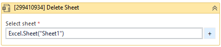

# Delete Sheet

RCA.Activities.Excel.Modern.DeleteSheetX

## **Description**

This activity deletes a sheet from the workbook.

This activity must be placed inside a **Use Excel File** scope.

(\* is mandatory)

## **In the body of the activity**

* **Select sheet (ExcelRangeRef)**\* - The sheet to delete from the workbook. Use the **+** button to build the reference.  
  E.g: `Excel.Sheet("Sheet2")`

## **Properties**

**Input**

* **Select sheet (ExcelRangeRef)**\* - The sheet to delete from the Excel workbook.  
  E.g: `Excel.Sheet("Sheet2")`

**Misc**

* **Public (Checkbox)** - Check if you want to publicize it. Remember to consider data security requirements before using it.
* **Display Name (String)** - The name of this activity. You can edit the name of the activity to organize and structure your code better.  
  E.g: Delete Sheet
