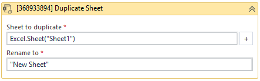

# Duplicate Sheet

RCA.Activities.Excel.Modern.DuplicateSheetX

## **Description**

This activity creates a copy of a sheet in the workbook and gives the copy the name you choose.

This activity must be placed inside a **Use Excel File** scope.

(\* is mandatory)

## **In the body of the activity**

* **Sheet to duplicate (ExcelRangeRef)**\* - The sheet to copy. Use the **+** button to build the reference.  
  E.g: `Excel.Sheet("Template")`
* **Rename to (String)**\* - The name of the new copy.  
  E.g: "March"

## **Properties**

**Input**

* **Sheet to duplicate (ExcelRangeRef)**\* - The sheet to copy.  
  E.g: `Excel.Sheet("Template")`
* **Rename to (String)**\* - The name of the new copy.  
  E.g: "March"

**Misc**

* **Public (Checkbox)** - Check if you want to publicize it. Remember to consider data security requirements before using it.
* **Display Name (String)** - The name of this activity. You can edit the name of the activity to organize and structure your code better.  
  E.g: Duplicate Sheet
