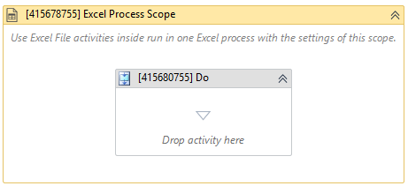

# Excel Process Scope

RCA.Activities.Excel.ExcelProcessScopeX

## **Description**

This activity starts or attaches to one Excel process with the settings you choose. The Excel file activities placed inside it use that process. When the scope started Excel itself, Excel is closed at the end of the scope.

Use it to control how Excel is launched (new or existing process, launch method, macro security, alerts and window visibility) for all the workbooks opened inside the scope, for example by several [Use Excel File](./use-excel-file.md) activities.

(\* is mandatory)

## **In the body of the activity**

* **"Do"** - The activities you want to execute with the Excel process. The settings of the scope are in the **Properties** panel.

## **Properties**

**Options**

* **Process mode (DropDownList)** - How the scope gets its Excel process. By default, ReuseIfExists is selected. The drop-down contains four options, as follows:  
  ・AlwaysCreateNew - Always start a new Excel.  
  ・ReuseIfExists - Use a running Excel; if there is none, start one.  
  ・AttendedUser - Use the Excel of the user.  
  ・OnlyIfExists - Fail when Excel is not running.
* **Launch method (DropDownList)** - How Excel is started. By default, Automation is selected. The drop-down contains two options, as follows:  
  ・Automation - Start Excel through COM automation.  
  ・Application - Start excel.exe like a user, then attach to it.
* **Launch timeout (seconds) (Int32)** - The number of seconds to wait for Excel to start when **Launch method** is Application. By default, this is 20.
* **File conflict resolution (DropDownList)** - What to do when a file opened in the scope is already open. The drop-down contains four options, as follows:  
  ・None - Use the open file.  
  ・PromptUser - Use the open file.  
  ・CloseWithoutSaving - Close the file without saving, then open it again from disk.  
  ・ThrowException - Fail with an error.
* **Existing process action (DropDownList)** - What to do with Excel processes that are already running before the scope starts. By default, None is selected. The drop-down contains two options, as follows:  
  ・None - Leave them running.  
  ・ForceKill - Kill the running Excel processes before starting.
* **Display alerts (Checkbox)** - When selected, the alerts of Excel are shown. By default, this check box is not selected.
* **Show Excel window (Checkbox)** - When selected, the Excel window is shown. A running Excel of the user is never hidden. By default, this check box is not selected.
* **Macro settings (DropDownList)** - The macro security of the process. By default, EnableAll is selected. The drop-down contains three options, as follows:  
  ・EnableAll - Enable all macros.  
  ・DisableAll - Disable all macros.  
  ・ReadFromExcelSettings - Use the macro settings configured in Excel.

**Misc**

* **Public (Checkbox)** - Check if you want to publicize it. Remember to consider data security requirements before using it.
* **Display Name (String)** - The name of this activity. You can edit the name of the activity to organize and structure your code better.  
  E.g: Excel Process Scope

## **Example: run two workbooks in one Excel process**

1. Add **Excel Process Scope**. Leave **Process mode** as ReuseIfExists and clear **Show Excel window**.
2. In its body, add a **Use Excel File** for `"C:\Data\Sales.xlsx"` and, below it, another **Use Excel File** for `"C:\Data\Targets.xlsx"`. Give them different **Reference as** names.
3. Run the workflow. Both workbooks are opened by the same Excel process. When the scope started Excel itself, Excel is closed when the scope ends.
