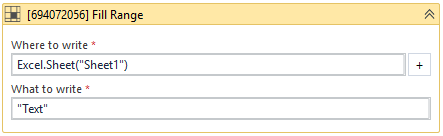

# Fill Range

RCA.Activities.Excel.Modern.FillRangeX

## **Description**

This activity writes one value into every cell of a range. To extend a pattern or formulas across a range like the fill handle of Excel, use [Auto Fill](./auto-fill.md) instead.

This activity must be placed inside a **Use Excel File** scope.

(\* is mandatory)

## **In the body of the activity**

* **Where to write (ExcelRangeRef)**\* - The range to fill with the value. Use the **+** button to build the reference.  
  E.g: `Excel.Range("Sheet1", "D2:D100")`
* **What to write (Object)**\* - The value written into every cell of the range.  
  E.g: "Pending"

## **Properties**

**Input**

* **Where to write (ExcelRangeRef)**\* - The range to fill with the value.  
  E.g: `Excel.Range("Sheet1", "D2:D100")`
* **What to write (Object)**\* - The value written into every cell of the range.  
  E.g: "Pending"

**Misc**

* **Public (Checkbox)** - Check if you want to publicize it. Remember to consider data security requirements before using it.
* **Display Name (String)** - The name of this activity. You can edit the name of the activity to organize and structure your code better.  
  E.g: Fill Range
