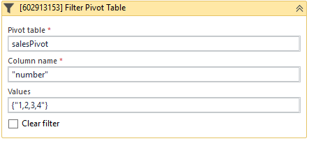

# Filter Pivot Table

RCA.Activities.Excel.Modern.FilterPivotTableX

## **Description**

This activity creates a filter in a pivot table based on the values of a single column. It can also clear the existing filters.

The activity shows a validation error when **Column name** is empty, or when **Values** is empty and **Clear filter** is not selected.

This activity must be placed inside a **Use Excel File** scope.

(\* is mandatory)

## **In the body of the activity**

* **Pivot table (ExcelPivotTableRef)**\* - The pivot table to filter. Use the variable that [Create Pivot Table](./create-pivot-table.md) saved.  
  E.g: salesPivot
* **Column name (String)** - The column used as a filter in the pivot table.  
  E.g: "Region"
* **Values (String[])** - The values the field may still show.  
  E.g: {"North", "South"}
* **Clear filter (Checkbox)** - See Options.

## **Properties**

**Input**

* **Pivot table (ExcelPivotTableRef)**\* - The pivot table to filter.  
  E.g: salesPivot
* **Column name (String)** - The column used as a filter in the pivot table.  
  E.g: "Region"
* **Values (String[])** - The values the field may still show.  
  E.g: {"North", "South"}

**Options**

* **Clear filter (Checkbox)** - When selected, any existing filters applied to the target range are cleared. By default, this check box is not selected.

**Misc**

* **Public (Checkbox)** - Check if you want to publicize it. Remember to consider data security requirements before using it.
* **Display Name (String)** - The name of this activity. You can edit the name of the activity to organize and structure your code better.  
  E.g: Filter Pivot Table

## **Example: show only two regions**

1. Inside a **Use Excel File** scope, after [Create Pivot Table](./create-pivot-table.md) has saved the pivot table in `salesPivot`, add **Filter Pivot Table**:
   * **Pivot table**: `salesPivot`
   * **Column name**: `"Region"`
   * **Values**: `{"North", "South"}`
2. Run the workflow. The pivot table shows only the regions *North* and *South*.
3. To remove the filter later, add another **Filter Pivot Table** with the same **Pivot table** and **Column name**, and select **Clear filter**.
