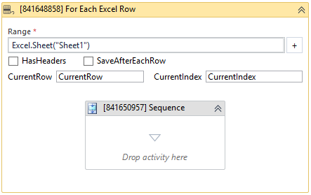

# For Each Excel Row

RCA.Activities.Excel.Modern.ExcelForEachRowX

## **Description**

This activity executes the activities in its body once for each row of a sheet, range or table. Each row is exposed to the body as the **CurrentRow** reference, together with the zero-based **CurrentIndex**.

This activity must be placed inside a **Use Excel File** scope. To stop the loop early or skip to the next row, use the **Excel Break** and **Excel Continue** activities inside the body.

The classic version of this activity, which works inside an **Excel Application Scope**, is [For Each Excel Row](../interop/for-each-excel-row.md).

(\* is mandatory)

## **In the body of the activity**

* **CurrentRow** - The loop variable that represents the row currently being processed (default name `CurrentRow`). You can rename it.
* **CurrentIndex** - The zero-based index of the current iteration (default name `CurrentIndex`). You can rename it.
* **Range (ExcelRangeRef)**\* - The sheet, range or table whose rows you want to iterate. Use the **+** button to build the reference.  
  E.g: `Excel.Table("Sheet1", "Table1")`
* **Body** - Add the activities that you want to execute for each row.

## **Properties**

**Input**

* **Range (ExcelRangeRef)**\* - The sheet, range or table whose rows you want to iterate.  
  E.g: `Excel.Sheet("Sheet1")`

**Options**

* **HasHeaders (Checkbox)** - When selected, the first row of the range is treated as a header and is skipped. By default, this check box is not selected.
* **SaveAfterEachRow (Checkbox)** - When selected, the workbook is saved after every row. By default, this check box is not selected.
* **Empty Row Behavior (DropDownList)** - How the loop treats empty rows. By default, Stop is selected. The drop-down contains four options, as follows:  
  ・StopAfterThreeConsecutiveEmptyRows - Stop after three consecutive empty rows.  
  ・Stop - Stop at the first empty row.  
  ・Skip - Skip empty rows and continue.  
  ・Process - Process empty rows like any other row.

**Misc**

* **Public (Checkbox)** - Check if you want to publicize it. Remember to consider data security requirements before using it.
* **Display Name (String)** - The name of this activity. You can edit the name of the activity to organize and structure your code better.  
  E.g: For Each Excel Row

## **Using CurrentRow**

`CurrentRow` is the same kind of row reference as in the classic [For Each Excel Row](../interop/for-each-excel-row.md#using-the-currentrow-delegate) activity. See that page for how to read a cell by header name, column letter or index, how to write a cell, and for `RowIndex`, `Address` and `FirstCell`.

## **Example: process each row of a table**

1. Add **Use Excel File** and enter the workbook path in **Excel file**.
2. Inside it, add **For Each Excel Row**:
   * **Range**: `Excel.Table("Sheet1", "Table1")`
   * Select **HasHeaders** so that the first row is skipped.
3. In the body, add the activities that process one row. Use `CurrentRow` to read the cells of the row and `CurrentIndex` for the number of the iteration, starting from 0.
4. Add **Excel Break** inside an **If** activity to stop the loop early, or **Excel Continue** to skip the rest of the current row.
5. Keep **Empty Row Behavior** as Stop to end the loop at the first empty row, or choose Skip to continue past empty rows.
