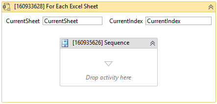

# For Each Excel Sheet

RCA.Activities.Excel.Modern.ForEachSheetX

## **Description**

This activity executes the activities in its body once for every worksheet of the workbook opened by **Use Excel File**. Each sheet is exposed to the body as the **CurrentSheet** reference, together with the zero-based **CurrentIndex**.

Because **CurrentSheet** is a sheet reference, you can pass it to any field that asks for a sheet, a range or a table, for example the **What to read** field of [Read Range](./read-range.md).

This activity must be placed inside a **Use Excel File** scope.

## **In the body of the activity**

* **CurrentSheet (ExcelRangeRef)** - The loop variable that represents the sheet currently being processed (default name `CurrentSheet`). You can rename it.
* **CurrentIndex (Int32)** - The zero-based index of the current iteration (default name `CurrentIndex`). You can rename it.
* **Body** - Add the activities that you want to execute for each sheet.

## **Properties**

**Misc**

* **Public (Checkbox)** - Check if you want to publicize it. Remember to consider data security requirements before using it.
* **Display Name (String)** - The name of this activity. You can edit the name of the activity to organize and structure your code better.  
  E.g: For Each Excel Sheet

## **Example: read every sheet of a workbook**

This example reads the data of every sheet into a DataTable, one sheet after the other.

1. Add **Use Excel File** and enter the workbook path in **Excel file**.
2. Inside it, add **For Each Excel Sheet**.
3. In the body of the loop, add [Read Range](./read-range.md):
   * **What to read**: `CurrentSheet`
   * **Save to**: a DataTable variable `dtSheet`
4. Add other activities that use `dtSheet`, for example **Log Message** with `CurrentIndex.ToString`. The loop runs once for each sheet, and `CurrentIndex` is 0 for the first sheet.
