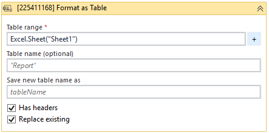

# Format as Table

RCA.Activities.Excel.Modern.CreateTableX

## **Description**

This activity formats a range of cells as an Excel table with the name you specify. The name of the new table is also returned, so the activities after it can refer to the table, for example with `Excel.Table("Sheet1", tableName)`.

This activity must be placed inside a **Use Excel File** scope.

(\* is mandatory)

## **In the body of the activity**

* **Table range (ExcelRangeRef)**\* - The range to format as a table. Use the **+** button to build the reference.  
  E.g: `Excel.Range("Sheet1", "A1:D10")`
* **Table name (optional) (String)** - The name of the new table. If left blank, a table name is generated automatically.  
  E.g: "SalesTable"
* **Has headers (Checkbox)** - See Options.
* **Replace existing (Checkbox)** - See Options.
* **Save new table name as (String)** - The variable that receives the name of the new table.  
  E.g: tableName

## **Properties**

**Input**

* **Table range (ExcelRangeRef)**\* - The range to format as a table.  
  E.g: `Excel.Range("Sheet1", "A1:D10")`
* **Table name (optional) (String)** - The name of the new table. If left blank, a table name is generated automatically.  
  E.g: "SalesTable"

**Options**

* **Has headers (Checkbox)** - When selected, the first row of the range is used as the header row of the table. By default, this check box is selected.
* **Replace existing (Checkbox)** - When selected, if a table with this name already exists, it is converted to a range so the new table can be created. By default, this check box is selected.

**Output**

* **Save new table name as (String)** - Where to save the name of the new table.  
  E.g: tableName

**Misc**

* **Public (Checkbox)** - Check if you want to publicize it. Remember to consider data security requirements before using it.
* **Display Name (String)** - The name of this activity. You can edit the name of the activity to organize and structure your code better.  
  E.g: Format as Table

## **Example: turn a range into a table and use it**

1. Inside a **Use Excel File** scope, add **Format as Table**:
   * **Table range**: `Excel.Range("Sheet1", "A1:D10")`
   * **Table name (optional)**: `"SalesTable"`
   * Keep **Has headers** selected.
   * **Save new table name as**: a new variable `tableName`
2. In the next activities, refer to the table with `Excel.Table("Sheet1", tableName)`, for example in [Sort](./sort.md) or [Read Range](./read-range.md).
