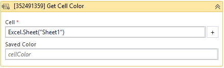

# Get Cell Color

RCA.Activities.Excel.Modern.GetCellColorX

## **Description**

This activity reads the background color of a cell and saves it to a Color variable.

This activity must be placed inside a **Use Excel File** scope.

(\* is mandatory)

## **In the body of the activity**

* **Cell (ExcelRangeRef)**\* - The cell whose background color you want to read. Use the **+** button to build the reference.  
  E.g: `Excel.Range("Sheet1", "B2")`
* **Saved Color (Color)** - The variable that receives the color.  
  E.g: cellColor

## **Properties**

**Input**

* **Cell (ExcelRangeRef)**\* - The address of the cell whose background color you want to read.  
  E.g: `Excel.Range("Sheet1", "B2")`

**Output**

* **Saved Color (Color)** - Where to save the Color of the specified cell.  
  E.g: cellColor

**Misc**

* **Public (Checkbox)** - Check if you want to publicize it. Remember to consider data security requirements before using it.
* **Display Name (String)** - The name of this activity. You can edit the name of the activity to organize and structure your code better.  
  E.g: Get Cell Color
