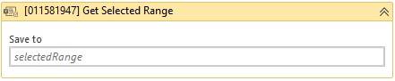

# Get Selected Range

RCA.Activities.Excel.Modern.GetSelectedRangeX

## **Description**

This activity gets the range that is currently selected in the Excel file and saves it as text.

This activity must be placed inside a **Use Excel File** scope.

(\* is mandatory)

## **In the body of the activity**

* **Save to (String)** - The variable that receives the selected range.  
  E.g: selectedRange

## **Properties**

**Output**

* **Save to (String)** - Where to save the selected range.  
  E.g: selectedRange

**Misc**

* **Public (Checkbox)** - Check if you want to publicize it. Remember to consider data security requirements before using it.
* **Display Name (String)** - The name of this activity. You can edit the name of the activity to organize and structure your code better.  
  E.g: Get Selected Range
