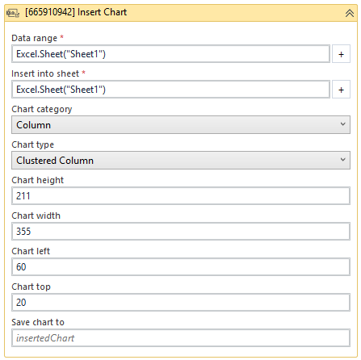

# Insert Chart

RCA.Activities.Excel.Modern.InsertExcelChartX

## **Description**

This activity creates a chart in a sheet from a data range. The new chart is also returned as a chart reference, which you pass to [Update Chart](./update-chart.md) and [Get Chart](./get-chart.md).

**Chart category** and **Chart type** work together: choose the category first, then one of the types of that category. The type **Other** cannot create a chart; the activity shows a validation error if it is selected.

This activity must be placed inside a **Use Excel File** scope.

(\* is mandatory)

## **In the body of the activity**

* **Data range (ExcelRangeRef)**\* - The data range to chart. Use the **+** button to build the reference.  
  E.g: `Excel.Range("Sheet1", "A1:B10")`
* **Insert into sheet (ExcelRangeRef)**\* - The sheet in which to insert the chart.  
  E.g: `Excel.Sheet("Dashboard")`
* **Chart category (DropDownList)** - See Input.
* **Chart type (DropDownList)** - See Input.
* **Chart height (Int32)** - See Input.
* **Chart width (Int32)** - See Input.
* **Chart left (Int32)** - See Input.
* **Chart top (Int32)** - See Input.
* **Save chart to (ExcelChartRef)** - The variable that receives the new chart.  
  E.g: salesChart

## **Properties**

**Input**

* **Data range (ExcelRangeRef)**\* - The data range to chart.  
  E.g: `Excel.Range("Sheet1", "A1:B10")`
* **Insert into sheet (ExcelRangeRef)**\* - The sheet in which to insert the chart.  
  E.g: `Excel.Sheet("Dashboard")`
* **Chart category (DropDownList)** - The kind of chart to create. By default, Column is selected. The drop-down contains six options, as follows:  
  ・Area  
  ・Bar  
  ・Column  
  ・Line  
  ・Pie  
  ・Scatter
* **Chart type (DropDownList)** - The chart to create, based on the selected category. By default, Clustered Column is selected. The available types are:  
  ・Area, Stacked Area, 100% Stacked Area  
  ・Clustered Bar, Stacked Bar, 100% Stacked Bar  
  ・Clustered Column, Stacked Column, 100% Stacked Column  
  ・Line, Stacked Line, 100% Stacked Line, Line with Markers, Stacked Line with Markers, 100% Stacked Line with Markers  
  ・Pie, Doughnut  
  ・Scatter, Scatter with Smooth Lines, Scatter with Smooth Lines and No Markers, Scatter with Straight Lines, Scatter with Straight Lines and No Markers  
  ・Other (cannot create a chart)
* **Chart height (Int32)** - The height of the chart. The designer fills in 211.  
  E.g: 300
* **Chart width (Int32)** - The width of the chart. The designer fills in 355.  
  E.g: 500
* **Chart left (Int32)** - The coordinate that sets how far to the right of the sheet the new chart appears. The designer fills in 60.  
  E.g: 20
* **Chart top (Int32)** - The coordinate that sets how far below the top of the sheet the new chart appears. The designer fills in 20.  
  E.g: 20

**Output**

* **Save chart to (ExcelChartRef)** - Saves the chart for use in other activities.  
  E.g: salesChart

**Misc**

* **Public (Checkbox)** - Check if you want to publicize it. Remember to consider data security requirements before using it.
* **Display Name (String)** - The name of this activity. You can edit the name of the activity to organize and structure your code better.  
  E.g: Insert Chart

## **Example: chart the sales and save it as a picture**

1. Inside a **Use Excel File** scope, add **Insert Chart**:
   * **Data range**: `Excel.Range("Data", "A1:B13")`
   * **Insert into sheet**: `Excel.Sheet("Dashboard")`
   * **Chart category**: Column
   * **Chart type**: Clustered Column
   * **Save chart to**: a new variable `salesChart`
2. Add [Update Chart](./update-chart.md) with **Chart** set to `salesChart`. Add the modification **Modify chart title**, select **Show title**, and set **Title** to `"Sales by month"`.
3. Add [Get Chart](./get-chart.md):
   * **Chart**: `salesChart`
   * **Action**: Save as picture
   * **File name**: `"C:\Reports\sales-chart.png"`
4. Run the workflow. The chart appears on the sheet *Dashboard* with the new title, and its picture is saved to the file.
