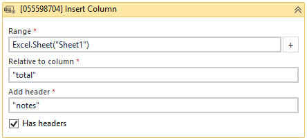

# Insert Column

RCA.Activities.Excel.Modern.InsertColumnX

## **Description**

This activity inserts a column in a sheet, table or range, next to a column you specify, and writes the header of the new column.

This activity must be placed inside a **Use Excel File** scope.

(\* is mandatory)

## **In the body of the activity**

* **Range (ExcelRangeRef)**\* - The sheet, table or range in which the column is inserted. Use the **+** button to build the reference.  
  E.g: `Excel.Table("Sheet1", "Table1")`
* **Relative to column (String)**\* - The column next to which the new column is inserted.  
  E.g: "Name"
* **Add header (String)**\* - The value to use for the header row of the new column.  
  E.g: "Status"
* **Has headers (Checkbox)** - See Options.

## **Properties**

**Input**

* **Range (ExcelRangeRef)**\* - The range in which the column will be inserted.  
  E.g: `Excel.Table("Sheet1", "Table1")`
* **Relative to column (String)**\* - The column next to which the new column will be inserted.  
  E.g: "Name"
* **Add header (String)**\* - The value to use for the header row.  
  E.g: "Status"

**Options**

* **Has headers (Checkbox)** - When selected, the first row in the range is a header row. By default, this check box is selected.

**Misc**

* **Public (Checkbox)** - Check if you want to publicize it. Remember to consider data security requirements before using it.
* **Display Name (String)** - The name of this activity. You can edit the name of the activity to organize and structure your code better.  
  E.g: Insert Column
