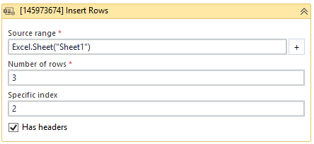

# Insert Rows

RCA.Activities.Excel.Modern.InsertRowsX

## **Description**

This activity inserts one or more rows in a table, range or sheet at the specified location.

This activity must be placed inside a **Use Excel File** scope.

(\* is mandatory)

## **In the body of the activity**

* **Source range (ExcelRangeRef)**\* - The sheet, range or table in which to insert the new rows. Use the **+** button to build the reference.  
  E.g: `Excel.Sheet("Sheet1")`
* **Number of rows (Int32)**\* - The number of rows to insert.  
  E.g: 2
* **Specific index (Int32)** - See Options.
* **Has headers (Checkbox)** - See Options.

## **Properties**

**Input**

* **Source range (ExcelRangeRef)**\* - The sheet, range or table in which to insert the new rows.  
  E.g: `Excel.Table("Sheet1", "Table1")`
* **Number of rows (Int32)**\* - The number of rows to insert.  
  E.g: 2

**Options**

* **Has headers (Checkbox)** - When selected, the first row in the range is a header row. By default, this check box is selected.
* **Specific index (Int32)** - The row number in the range after which to insert the new rows. Leave empty to insert after the last row of the range.  
  E.g: 5

**Misc**

* **Public (Checkbox)** - Check if you want to publicize it. Remember to consider data security requirements before using it.
* **Display Name (String)** - The name of this activity. You can edit the name of the activity to organize and structure your code better.  
  E.g: Insert Rows

## **Example: insert two rows after the fifth row**

1. Inside a **Use Excel File** scope, add **Insert Rows**:
   * **Source range**: `Excel.Table("Sheet1", "Table1")`
   * **Number of rows**: `2`
   * **Specific index**: `5`
2. Run the workflow. Two new rows are inserted after row 5 of the table. If you leave **Specific index** empty, the rows are inserted after the last row of the table.
