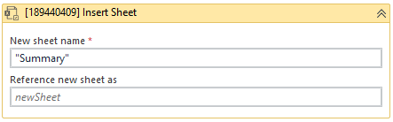

# Insert Sheet

RCA.Activities.Excel.Modern.InsertSheetX

## **Description**

This activity inserts a new sheet in the workbook. The new sheet is also returned as a sheet reference, so the activities after it can work on it, for example [Write DataTable to Excel](./write-datatable-to-excel.md) or [Rename Sheet](./rename-sheet.md).

This activity must be placed inside a **Use Excel File** scope.

(\* is mandatory)

## **In the body of the activity**

* **New sheet name (String)**\* - The name of the new sheet.  
  E.g: "Report"
* **Reference new sheet as (ExcelRangeRef)** - The variable that receives a reference to the new sheet.  
  E.g: reportSheet

## **Properties**

**Input**

* **New sheet name (String)**\* - The name of the new sheet.  
  E.g: "Report"

**Output**

* **Reference new sheet as (ExcelRangeRef)** - The name you will use to refer to the new sheet in other activities.  
  E.g: reportSheet

**Misc**

* **Public (Checkbox)** - Check if you want to publicize it. Remember to consider data security requirements before using it.
* **Display Name (String)** - The name of this activity. You can edit the name of the activity to organize and structure your code better.  
  E.g: Insert Sheet

## **Example: create a sheet and write data into it**

1. Inside a **Use Excel File** scope, add **Insert Sheet**:
   * **New sheet name**: `"Report"`
   * **Reference new sheet as**: a new variable `reportSheet`
2. Below it, add **Write DataTable to Excel**:
   * **What to write**: `dtSales`
   * **Destination**: `reportSheet`
3. Run the workflow. The sheet *Report* is created and filled with the data. Because the new sheet is saved in `reportSheet`, the later activities can use it without writing `Excel.Sheet("Report")`.
