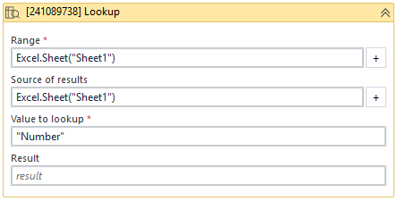

# Lookup

RCA.Activities.Excel.Modern.LookupX

## **Description**

This activity searches for a value in the first column of a range and returns the paired value from a result range, like the LOOKUP function of Excel. The result is `null` when nothing matches.

For a search that returns a cell from the matching row, use [VLookup](./vlookup.md). To get the position of a value instead, use [Match Function](./match-function.md).

This activity must be placed inside a **Use Excel File** scope.

(\* is mandatory)

## **In the body of the activity**

* **Range (ExcelRangeRef)**\* - The range, table or sheet to search in. Use the **+** button to build the reference.  
  E.g: `Excel.Range("Sheet1", "A2:A100")`
* **Value to lookup (Object)**\* - The value to search for in the first column of the source range.  
  E.g: "INV-0042"
* **Source of results (ExcelRangeRef)** - A single row or column with the values to return, paired with the source range.  
  E.g: `Excel.Range("Sheet1", "C2:C100")`
* **Result (Object)** - The variable that receives the value found.  
  E.g: foundValue

## **Properties**

**Input**

* **Range (ExcelRangeRef)**\* - The range, table or sheet to search in.  
  E.g: `Excel.Range("Sheet1", "A2:A100")`
* **Value to lookup (Object)**\* - The value to search for in the first column of the source range.  
  E.g: "INV-0042"
* **Source of results (ExcelRangeRef)** - A single row or column with the values to return, paired with the source range.  
  E.g: `Excel.Range("Sheet1", "C2:C100")`

**Output**

* **Result (Object)** - The value found, or null when nothing matches.  
  E.g: foundValue

**Misc**

* **Public (Checkbox)** - Check if you want to publicize it. Remember to consider data security requirements before using it.
* **Display Name (String)** - The name of this activity. You can edit the name of the activity to organize and structure your code better.  
  E.g: Lookup

## **Example: find the price of a product**

The sheet *Prices* lists product codes in A2:A100 and prices in C2:C100.

1. Inside a **Use Excel File** scope, add **Lookup**:
   * **Range**: `Excel.Range("Prices", "A2:A100")`
   * **Value to lookup**: `"P-1002"`
   * **Source of results**: `Excel.Range("Prices", "C2:C100")`
   * **Result**: a new variable `price`
2. Use `price` in the next activities. If the code is not in the range, `price` is `null`, so check it with an **If** activity before using it.
