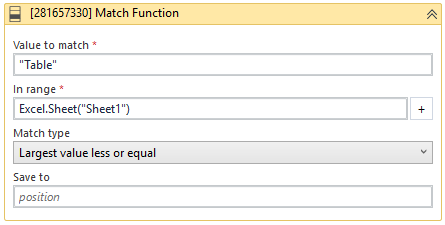

# Match Function

RCA.Activities.Excel.Modern.MatchFunctionX

## **Description**

This activity reports the position of a value within a single row or column, like the MATCH function of Excel. The position is relative to the searched range. The result is -1 when the value is not found.

This activity must be placed inside a **Use Excel File** scope.

(\* is mandatory)

## **In the body of the activity**

* **Value to match (Object)**\* - The value to search for.  
  E.g: "INV-0042"
* **In range (ExcelRangeRef)**\* - The single row or column to search in. Use the **+** button to build the reference.  
  E.g: `Excel.Range("Sheet1", "A1:A100")`
* **Match type (DropDownList)** - See Options.
* **Save to (Int32)** - The variable that receives the position.  
  E.g: position

## **Properties**

**Input**

* **Value to match (Object)**\* - The value to search for.  
  E.g: "INV-0042"
* **In range (ExcelRangeRef)**\* - The single row or column to search in.  
  E.g: `Excel.Range("Sheet1", "A1:A100")`

**Options**

* **Match type (DropDownList)** - How the value is compared against the range. By default, LargestValueLessOrEqual is selected. The drop-down contains three options, as follows:  
  ・LargestValueLessOrEqual - Finds the largest value that is less than or equal to the value to match.  
  ・ExactlyEqual - Finds the first value that is exactly equal to the value to match.  
  ・SmallestValueGreaterOrEqual - Finds the smallest value that is greater than or equal to the value to match.

**Output**

* **Save to (Int32)** - Where to save the relative position of the value, or -1 when it is not found.  
  E.g: position

**Misc**

* **Public (Checkbox)** - Check if you want to publicize it. Remember to consider data security requirements before using it.
* **Display Name (String)** - The name of this activity. You can edit the name of the activity to organize and structure your code better.  
  E.g: Match Function

## **Example: find the row of an invoice**

1. Inside a **Use Excel File** scope, add **Match Function**:
   * **Value to match**: `"INV-0042"`
   * **In range**: `Excel.Range("Invoices", "A1:A100")`
   * **Match type**: ExactlyEqual
   * **Save to**: a new variable `position`
2. Run the workflow. `position` is the relative position of `INV-0042` in A1:A100, for example 7 when it is in A7. It is -1 when the value is not in the range.
