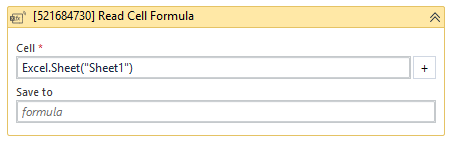

# Read Cell Formula

RCA.Activities.Excel.Modern.ReadCellFormulaX

## **Description**

This activity reads the formula of one cell and saves it as text. To read the value of a cell, use [Read Cell Value](./read-cell-value.md).

This activity must be placed inside a **Use Excel File** scope.

(\* is mandatory)

## **In the body of the activity**

* **Cell (ExcelRangeRef)**\* - The cell from which to read the formula. Use the **+** button to build the reference.  
  E.g: `Excel.Range("Sheet1", "C2")`
* **Save to (String)** - The variable that receives the formula.  
  E.g: cellFormula

## **Properties**

**Input**

* **Cell (ExcelRangeRef)**\* - The address of the cell from which to read the formula.  
  E.g: `Excel.Range("Sheet1", "C2")`

**Output**

* **Save to (String)** - Where to save the formula read from the cell.  
  E.g: cellFormula

**Misc**

* **Public (Checkbox)** - Check if you want to publicize it. Remember to consider data security requirements before using it.
* **Display Name (String)** - The name of this activity. You can edit the name of the activity to organize and structure your code better.  
  E.g: Read Cell Formula
