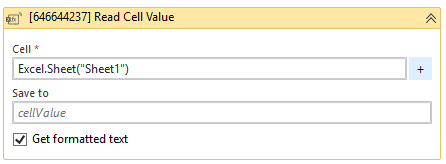

# Read Cell Value

RCA.Activities.Excel.Modern.ReadCellValueX

## **Description**

This activity reads the value of one cell and saves it to a variable. Use **Get formatted text** to choose between the text as Excel displays it and the raw value. To read the formula of a cell instead, use [Read Cell Formula](./read-cell-formula.md).

This activity must be placed inside a **Use Excel File** scope.

(\* is mandatory)

## **In the body of the activity**

* **Cell (ExcelRangeRef)**\* - The cell to read. Use the **+** button to build the reference.  
  E.g: `Excel.Range("Sheet1", "B2")`
* **Get formatted text (Checkbox)** - See Options.
* **Save to (Object)** - The variable that receives the value.  
  E.g: cellValue

## **Properties**

**Input**

* **Cell (ExcelRangeRef)**\* - The address of the cell from which to read the value.  
  E.g: `Excel.Range("Sheet1", "B2")`

**Options**

* **Get formatted text (Checkbox)** - When selected, the value is retrieved including any formatting applied in Excel. When cleared, the raw value is retrieved. By default, this check box is selected.

**Output**

* **Save to (Object)** - Where to save the value read from the cell.  
  E.g: cellValue

**Misc**

* **Public (Checkbox)** - Check if you want to publicize it. Remember to consider data security requirements before using it.
* **Display Name (String)** - The name of this activity. You can edit the name of the activity to organize and structure your code better.  
  E.g: Read Cell Value
