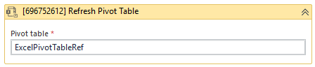

# Refresh Pivot Table

RCA.Activities.Excel.Modern.RefreshPivotTableX

## **Description**

This activity updates the data of a pivot table, for example after the source data changed.

This activity must be placed inside a **Use Excel File** scope.

(\* is mandatory)

## **In the body of the activity**

* **Pivot table (ExcelPivotTableRef)**\* - The pivot table to refresh. Use the variable that [Create Pivot Table](./create-pivot-table.md) saved.  
  E.g: salesPivot

## **Properties**

**Input**

* **Pivot table (ExcelPivotTableRef)**\* - The pivot table to refresh.  
  E.g: salesPivot

**Misc**

* **Public (Checkbox)** - Check if you want to publicize it. Remember to consider data security requirements before using it.
* **Display Name (String)** - The name of this activity. You can edit the name of the activity to organize and structure your code better.  
  E.g: Refresh Pivot Table
