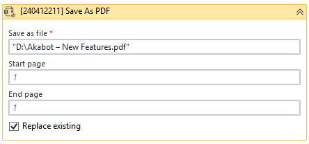

# Save As PDF

RCA.Activities.Excel.Modern.SaveAsPdfX

## **Description**

This activity saves the Excel file as a PDF file. You can export only some pages with **Start page** and **End page**.

The activity fails with an error in these cases:

* The file name is empty.
* **Start page** or **End page** is smaller than 0.
* **Start page** is not smaller than **End page**.
* The target file already exists and **Replace existing** is cleared.

This activity must be placed inside a **Use Excel File** scope.

(\* is mandatory)

## **In the body of the activity**

* **Save as file (String)**\* - The name of the new PDF file.  
  E.g: "C:\Reports\Sales.pdf"
* **Start page (Int32)** - See Options.
* **End page (Int32)** - See Options.
* **Replace existing (Checkbox)** - See Options.

## **Properties**

**Input**

* **Save as file (String)**\* - The name of the new PDF file.  
  E.g: "C:\Reports\Sales.pdf"

**Options**

* **Start page (Int32)** - Start the export at this page.  
  E.g: 1
* **End page (Int32)** - Stop the export at this page.  
  E.g: 3
* **Replace existing (Checkbox)** - When selected, a file with the same name is replaced. When cleared, an error occurs if the file already exists. By default, this check box is selected.

**Misc**

* **Public (Checkbox)** - Check if you want to publicize it. Remember to consider data security requirements before using it.
* **Display Name (String)** - The name of this activity. You can edit the name of the activity to organize and structure your code better.  
  E.g: Save As PDF

## **Example: save the first three pages as PDF**

1. Inside a **Use Excel File** scope, add **Save As PDF**:
   * **Save as file**: `"C:\Reports\Sales.pdf"`
   * **Start page**: `1`
   * **End page**: `3`
   * Keep **Replace existing** selected.
2. Run the workflow. The PDF file is created at the given path. The folder must already exist.
