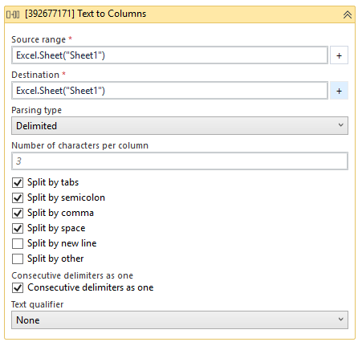

# Text to Columns

RCA.Activities.Excel.Modern.TextToColumnsX

## **Description**

This activity splits the text of a range into columns, as the Text to Columns wizard of Excel does. The text is split either on delimiter characters or at fixed character widths.

The destination must be on the same sheet as the source. The activity shows a validation error in these cases:

* **Parsing type** is Delimited and no delimiter is selected.
* **Split by other** is selected and **Other delimiter** is empty.
* **Other delimiter** is used together with **Split by new line**.
* **Parsing type** is FixedWidth and **Number of characters per column** is empty.

This activity must be placed inside a **Use Excel File** scope.

(\* is mandatory)

## **In the body of the activity**

* **Source range (ExcelRangeRef)**\* - The range with the text to split. Use the **+** button to build the reference.  
  E.g: `Excel.Range("Sheet1", "A2:A100")`
* **Destination (ExcelRangeRef)**\* - Where the split result is written. Must be on the same sheet as the source.  
  E.g: `Excel.Range("Sheet1", "B2")`
* **Parsing type (DropDownList)** - See Options.
* **Number of characters per column (Int32)** - See Options.
* **Split by tabs / semicolon / comma / space / new line / other (Checkbox)** - See Options.
* **Other delimiter (Char)** - See Options.
* **Consecutive delimiters as one (Checkbox)** - See Options.
* **Text qualifier (DropDownList)** - See Options.

## **Properties**

**Input**

* **Source range (ExcelRangeRef)**\* - The range with the text to split.  
  E.g: `Excel.Range("Sheet1", "A2:A100")`
* **Destination (ExcelRangeRef)**\* - Where the split result is written. Must be on the same sheet.  
  E.g: `Excel.Range("Sheet1", "B2")`

**Options**

* **Parsing type (DropDownList)** - Split on delimiter characters or at fixed character widths. By default, Delimited is selected. The drop-down contains two options, as follows:  
  ・Delimited - Split on the delimiters selected below.  
  ・Fixed width - Split every **Number of characters per column** characters.
* **Number of characters per column (Int32)** - The column width in characters, for the Fixed width mode.  
  E.g: 10
* **Split by tabs (Checkbox)** - Split on tab characters. By default, this check box is selected.
* **Split by semicolon (Checkbox)** - Split on semicolons. By default, this check box is selected.
* **Split by comma (Checkbox)** - Split on commas. By default, this check box is selected.
* **Split by space (Checkbox)** - Split on spaces. By default, this check box is selected.
* **Split by new line (Checkbox)** - Split on line breaks. By default, this check box is not selected.
* **Split by other (Checkbox)** - Split on the custom character set in **Other delimiter**. By default, this check box is not selected.
* **Other delimiter (Char)** - The single character to split on.  
  E.g: "|"
* **Consecutive delimiters as one (Checkbox)** - When selected, two delimiters in a row are treated as one, so empty cells are not produced. By default, this check box is selected.
* **Text qualifier (DropDownList)** - The character that wraps text containing delimiter characters. By default, None is selected. The drop-down contains three options, as follows:  
  ・None  
  ・Double quote  
  ・Single quote

**Misc**

* **Public (Checkbox)** - Check if you want to publicize it. Remember to consider data security requirements before using it.
* **Display Name (String)** - The name of this activity. You can edit the name of the activity to organize and structure your code better.  
  E.g: Text to Columns

## **Example: split full names into separate columns**

Column A of *Sheet1* holds names such as `Nguyen Van An`, from A2 to A100. This example splits each name at the spaces and writes the parts starting in column B.

1. Inside a **Use Excel File** scope, add **Text to Columns**:
   * **Source range**: `Excel.Range("Sheet1", "A2:A100")`
   * **Destination**: `Excel.Range("Sheet1", "B2")`
   * **Parsing type**: Delimited
2. Clear **Split by tabs**, **Split by semicolon** and **Split by comma**. Keep **Split by space** selected.
3. Run the workflow. Each name is split at the spaces and written to the cells to the right of B2, starting in column B.
