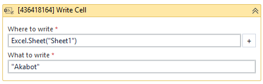

# Write Cell

RCA.Activities.Excel.Modern.WriteCellX

## **Description**

This activity enters a text, a number or a formula in one cell of the workbook.

This activity must be placed inside a **Use Excel File** scope.

(\* is mandatory)

## **In the body of the activity**

* **Where to write (ExcelRangeRef)**\* - The cell in which to write. Use the **+** button to build the reference.  
  E.g: `Excel.Range("Sheet1", "B2")`
* **What to write (Object)**\* - The value or formula to enter into the cell.  
  E.g: "Total", 100 or "=SUM(A1:A10)"

## **Properties**

**Input**

* **Where to write (ExcelRangeRef)**\* - The cell in which to write the value or formula.  
  E.g: `Excel.Range("Sheet1", "B2")`
* **What to write (Object)**\* - The value or formula to enter into the cell.  
  E.g: "=SUM(A1:A10)"

**Misc**

* **Public (Checkbox)** - Check if you want to publicize it. Remember to consider data security requirements before using it.
* **Display Name (String)** - The name of this activity. You can edit the name of the activity to organize and structure your code better.  
  E.g: Write Cell
