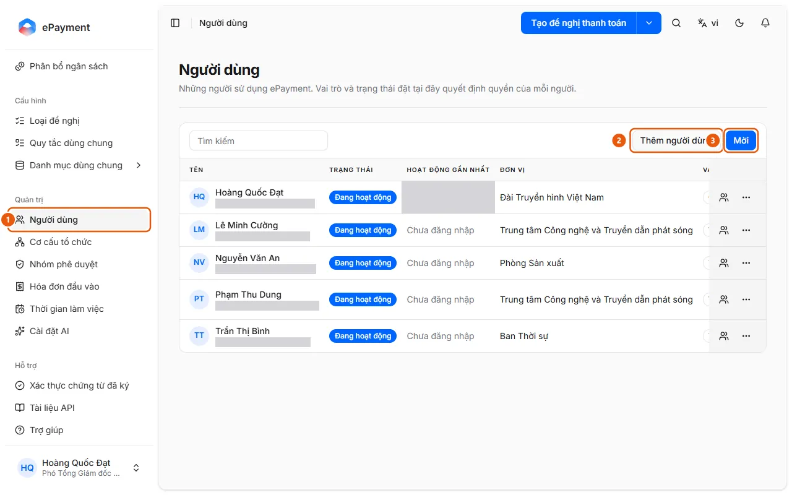
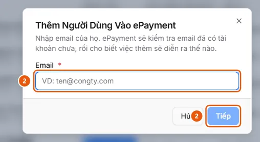

# Add or invite users

In Users, click Add user (verify each email) or Invite (multiple emails with the same role).

## Before you start

- **[Cannot delete or disable while still in use](../../../reference/admin/directory-delete-guards.md)**\
  Units with child units, members, requests, or allocations cannot be deleted; groups with members or currently used by a request type cannot be deleted.

## Steps

1. In the sidebar, under **Administration**, open **Users** (1).

   

2. To add one user: click **Add user** (2), enter an email, then click **Next** (2). Follow the result of the check:
   - Already an ePayment user: no need to add them again.
   - Already a company member: click **Add**; they get access to ePayment immediately, and no email is sent.
   - Has an account but isn't in the company: click **Send invitation**; they receive an email and join after accepting.
   - Doesn't have an account: enter **First name**, **Last name**, and **Temporary password** (at least 6 characters; they change the password when they first sign in), then click **Create account**; copy the password immediately because it is shown only once.

   

3. To invite multiple people: click **Invite** (3), enter each email (press Enter to add an email), select a **Role** (Member by default), then click **Save**; the page displays "Users invited," and they set their own password the first time they sign in. Invited users receive an email and join using Join company from the invitation (akabot-identity).
4. For a pending row, use **Resend invitation** or **Revoke invitation**.
5. In the row's **Actions** menu, set the **Approval group**, **Unit**, and **Role** (Member, Operator, Administrator), **Reset signing password**, or **Disable** (**Reactivate** to enable the user again).

## Troubleshooting

- Email verification fails: "Unable to verify this email. Please try again." You cannot disable the account owner, department head, or last administrator: see [Cannot delete or disable while still in use](../../../reference/admin/directory-delete-guards.md).

## See also

- akabot-identity:goal.members.invite (akabot-identity)
- akabot-identity:goal.members.add-user (akabot-identity)

## Used in these guides

- [Invite a new user to ePayment](../invite-user.md) — For administrators who want to give a colleague access to ePayment.
