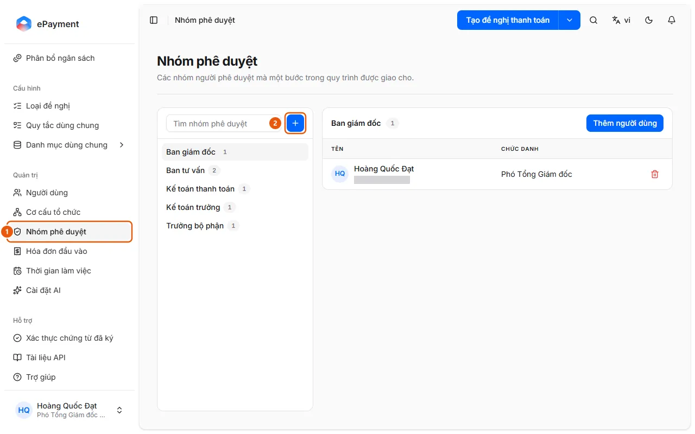

# Add or Edit an Approval Group

In Approval Groups, click Add Approval Group, then add or remove members.

## Before you start

- **[Cannot delete or disable items that are still in use](../../../reference/admin/directory-delete-guards.md)**\
  An organizational unit cannot be deleted while it has child units, members, requests, or allocations. An approval group cannot be deleted while it has members or is used by a request type.

## Steps

1. In the sidebar, under **Administration**, open **Approval Groups** (1).

   

2. Click **Add Approval Group** (+ button, 2) and enter a **Name** and **Description**, then click **Save**; or use the group's **Actions** menu: **Add Users**, **Edit Approval Group**, **Delete Approval Group**.
3. Select a group and click **Add Users** to add members; click the trash icon on a member's row to remove them from the group.
4. Assign the group to a step in the **Approval Flow** tab of the request type ([Configure and publish a request type](../../config/how-to/publish-request-type.md)).

## Troubleshooting

- Cannot delete a group: see [Cannot delete or disable items that are still in use](../../../reference/admin/directory-delete-guards.md).

## Used in these guides

- [Manage approver groups](../manage-approval-group.md) — For administrators who want to change the approver for a step in an approval flow by editing the group's membership.
