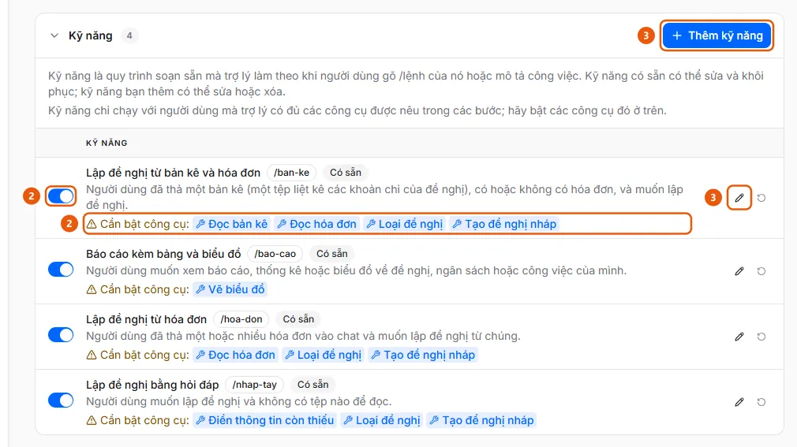

# Add or edit an assistant skill

In AI Settings, open the Assistant tab and the Skills section, then click Add skill or the pencil icon to edit a skill. You can enable, disable, restore, or delete skills from their rows.

## Steps

1. In the sidebar, under **Administration**, open **AI Settings** (available to administrators on desktop) and select the **Assistant** tab.
2. Open the **Skills** section (the four built-in skills are labeled **Available**; each row has an enable/disable toggle (2). If the assistant is missing a tool required by a skill, the row displays "Tools to enable:" (2), followed by the tool name).

   

3. Click **Add skill** (3) (up to 50 skills per organization), or click the pencil icon (3) on a row to edit a skill. The dialog includes **Name**, **Command** (users type /command in the chat box; use lowercase letters, numbers, and hyphens (-), and make sure the command is unique), **When to use**, **Steps** (type @ to insert a tool), and the **Show on welcome screen** toggle.
4. Click **Save** ("Skill saved.").
5. To discard changes to a built-in skill (a row labeled **Modified**), click the circular arrow **Restore defaults** icon and confirm. Skills added by your organization have a **Delete** button instead (this action cannot be undone).
6. Enable the tools required by the skill in the **Assistant tools** section ([Enable assistant tools](enable-assistant-tools.md)). The skill only runs for users whose assistant has all the required tools enabled.

## Features used

- [AI assistant skills](../../assistant/features/skills.md) — Ready-made recipes with steps written in natural language. Users run them by entering a command beginning with / in the chat box, and administrators manage them.

## Used in these guides

- [Manage AI assistant skills](../manage-assistant-skill.md) — For administrators who want to add, edit, disable, or restore a skill (a / command) so the assistant can follow a company process.
