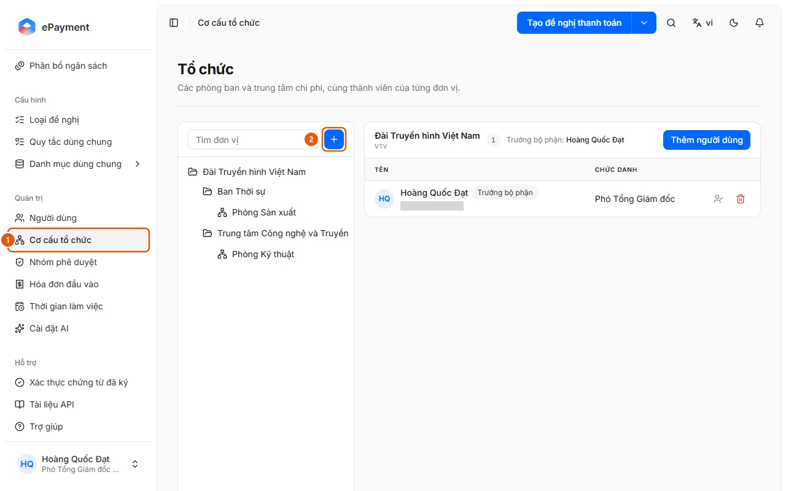

# Add or edit an organization unit

In Organization Structure, click Add unit or Add child unit, then add users and set a department head.

## Before you start

- **[Cannot delete or disable while in use](../../../reference/admin/directory-delete-guards.md)**\
  A unit cannot be deleted while it has child units, members, requests, or allocations. A group cannot be deleted while it has members or is used by a request type.

## Steps

1. In the sidebar, under **Administration**, open **Organization Structure** (1) (the unit tree on the left with a "Search units" box, and members on the right).

   

2. Click **Add unit** (the + button, 2), or select **Add child unit** from a unit's **Actions** menu; select **Edit unit** to make changes.
3. Enter the **Name**, **Code** (use uppercase letters, numbers, hyphens (-), or underscores), and **Description**, then click **Save**.
4. Select a unit and click **Add users** to add members. In a member's row, use **Set as department head** to route approval steps assigned to the department head to that person, or select **Remove from unit**.
5. Use **Delete unit** when the unit is no longer needed.

## Troubleshooting

- Cannot delete a unit: see [Cannot delete or disable while in use](../../../reference/admin/directory-delete-guards.md).

## Used in these guides

- [Manage organization structure](../manage-organization.md) — For administrators who want to add departments, move people between units, or set a department head.
