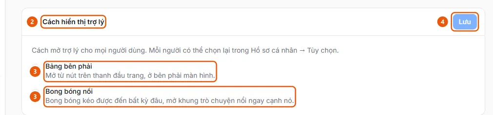

# Set the assistant's default display

In AI Settings, on the Assistant tab, under Assistant display, select Right panel or Floating bubble for all users, then click Save.

## Steps

1. In the sidebar, under **Administration**, open **AI Settings** (administrators only, on desktop) and select the **Assistant** tab.
2. Expand **Assistant display** (2).

   

3. Select **Right panel** (3) (opens from the button in the top bar) or **Floating bubble** (3) (a draggable bubble that can be moved anywhere and opens a floating chat panel right beside it).
4. Click **Save** (4). This is the organization default; each person can change it in **Personal profile** → **Preferences** ([Choose how the assistant opens in Preferences](../../profile/how-to/set-assistant-display.md)), and on mobile, the assistant always opens in the **Right panel**.

## Used in these guides

- [Set the default way the assistant opens: Right panel or Floating bubble](../set-assistant-display.md) — For administrators who want to choose how the assistant opens for the entire organization: Right panel or a draggable Floating bubble.
