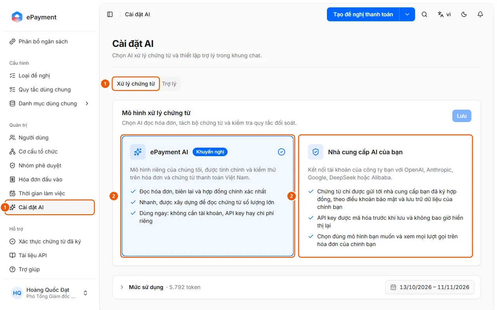

# Choose an AI Model for Document Processing

In AI Settings, open the Document Processing tab, choose AkaPayment AI or Your AI Provider (provider, model, API key), then click Save to validate and apply your selection.

## Steps

1. In the sidebar, under **Administration**, open **AI Settings** (admins only, on desktop), then select the **Document Processing** tab (1).

   

2. In the **Document Processing Model** card, select **AkaPayment AI** (recommended; no key required) or **Your AI Provider** (2).
3. If you choose your own provider: select a **Provider** (OpenAI, Anthropic, Google Gemini, DeepSeek, Alibaba Qwen), select or enter a model ID in the **Model** field (the model must be able to read images), and enter your **API key**. Use **Advanced** → **Base URL** only for an OpenAI-compatible server or proxy.
4. Click **Save**. For your own provider, the page displays "Checking … This may take a minute or two." Once validation succeeds, the model is applied ("Model applied.").

## Troubleshooting

- "… did not pass validation. The current model is still in use.": Check the reason shown for each item: **Connection**, **Image Reading**, and **Structured Response** (or **Test** if validation did not complete). Update the key, model ID, or Base URL, then click **Save** again (you don't need to re-enter the key). See [When your organization uses its own AI model](../../../reference/ai/own-model.md).

## Notes

- **[When your organization uses its own AI model](../../../reference/ai/own-model.md)**\
  Your own model must pass validation before it can be applied. The key is not displayed again. If the provider fails, AI features stop working; they do not automatically switch to AkaPayment AI.

## Used in these guides

- [Choose AI for invoice reading and document processing](../set-document-model.md) — For admins who want to choose an AI model to read invoices, split document packages, and check reconciliation rules: AkaPayment AI or the company's AI account.
