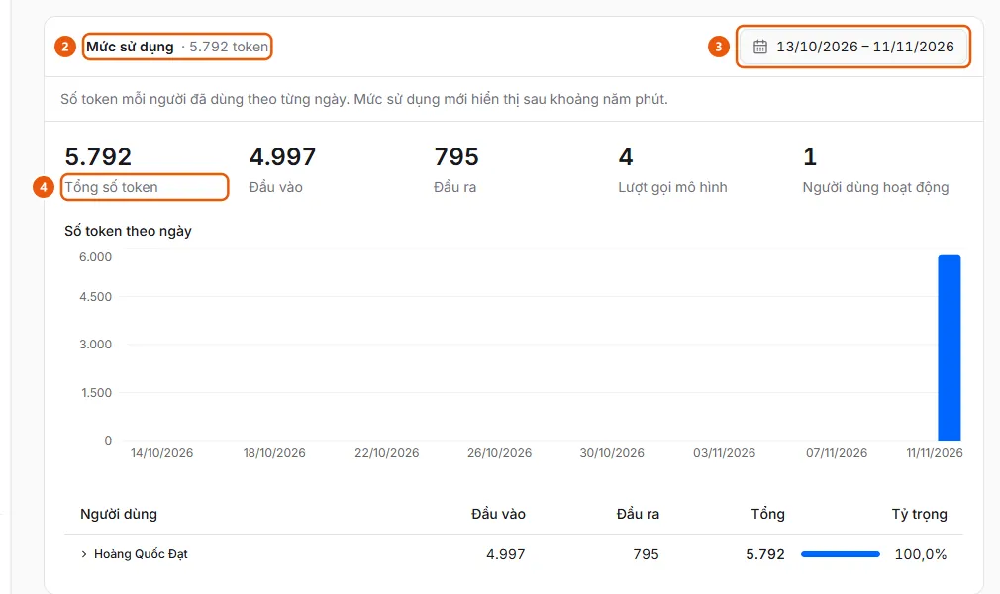

# View AI Token Usage

In AI Settings, open Usage at the bottom of the Document Processing or Assistant tab, select a date range, and view tokens by day and by user.

## Steps

1. In the sidebar, under **Administration**, open **AI Settings** (administrators only, on desktop); select the **Document Processing** tab (invoice reading, document splitting, reconciliation) or the **Assistant** tab (chat panel).
2. Scroll to the bottom of the tab and open the **Usage** section (2) (the heading already shows the total tokens for the date range).

   

3. Select a date range in the date field (3) at the top of the section (defaults to the last 30 days; dates use the organization’s time zone).
4. View **Total tokens** (4), **Input**, **Output**, **Model calls**, **Active users**, the tokens-per-day chart, and the **Users** table with **Share**; click the arrow on a row to view that user’s daily usage.

## Troubleshooting

- Recent usage is not shown yet: new usage appears after about five minutes. The **Other** row groups usage that could not be associated with an ePayment user.
- Date ranges longer than 366 days are rejected: select a shorter range.

## Used in these guides

- [View how many AI tokens each user consumes](../view-ai-usage.md) — Administrators who want to view AI token usage by day and by user, for document processing and the assistant.
