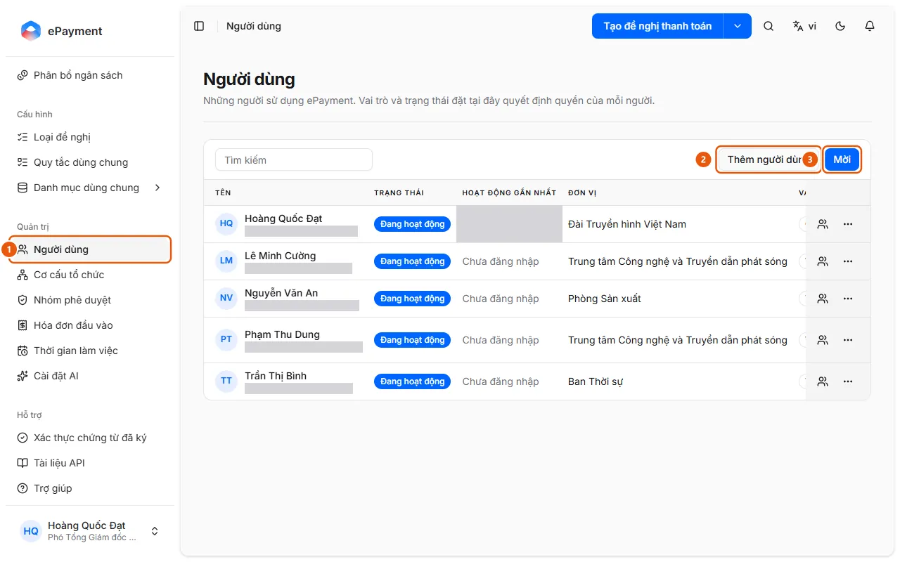
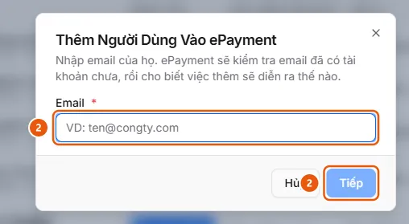

# Invite a new user to ePayment

An administrator wants to give a colleague access to ePayment.

**When to use:**

- A new employee needs to use ePayment.
- An administrator wants to grant a colleague access to ePayment.

Add or invite users by email, then assign their role and unit.

## Ways to do this

- [Add or invite users](how-to/invite-user.md) — In Users, click Add user (check each email) or Invite (multiple emails with the same role).

## Before you start

- **[Cannot delete or disable while in use](../../reference/admin/directory-delete-guards.md)**\
  A unit cannot be deleted if it has child units, members, requests, or allocations; a group cannot be deleted if it has members or is used by a request type.

## Steps

[Add or invite users](how-to/invite-user.md)

1. [Add or invite users](how-to/invite-user.md)
   1. In the sidebar, under **Administration**, open **Users** (1).
      
   2. To add one person: click **Add user** (2), enter an email, then click **Continue** (2). Follow the validation result:
      
   3. To invite multiple people: click **Invite** (3), enter each email (press Enter to add an email), select a **Role** (Member by default), then click **Save**. The page displays "User invited". Invitees set their own password the first time they sign in. They receive an email and join through Join company from invitation (akabot-identity).
   4. For a pending invitation, use **Resend invitation** or **Revoke invitation**.
   5. In the row's **Actions** menu, set the **Approval group**, **Unit**, or **Role** (Member, Operator, Admin); **Reset signing password**; or **Disable** (**Reactivate** to enable the user again).

## Troubleshooting

### [Add or invite users](how-to/invite-user.md)

- Email validation fails: "Unable to validate this email. Please try again." You cannot disable the account owner, department head, or last administrator. See [Cannot delete or disable while in use](../../reference/admin/directory-delete-guards.md).
