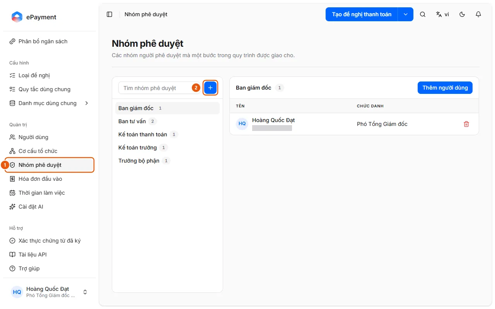

# Manage approver groups

An administrator wants to change the approver at a step in an approval flow by editing the group members.

**When to use:**

- A new chief accountant needs to take over approvals.
- An administrator wants to change the members of an approver group.

Approver group members receive tasks at the approval steps for a request type.

## How to do it

- [Add or edit an approver group](how-to/manage-approval-group.md) — In Approval Groups, click Add approval group, then add or remove members.

## Before you start

- **[Cannot delete or disable while in use](../../reference/admin/directory-delete-guards.md)**\
  An organizational unit cannot be deleted if it has child units, members, requests, or allocations. A group cannot be deleted if it has members or is used by a request type.

## Steps

[Add or edit an approver group](how-to/manage-approval-group.md)

1. [Add or edit an approver group](how-to/manage-approval-group.md)
   1. In the sidebar, under **Administration**, open **Approval Groups** (1).
      
   2. Click **Add approval group** (+ button, 2) and enter a **Name** and **Description**, then click **Save**; or use the group's **Actions** menu to choose **Add users**, **Edit approval group**, or **Delete approval group**.
   3. Select a group and click **Add users** to add members; click the trash icon in a member's row to remove them from the group.
   4. Assign the group to a step on the **Approval Flow** tab of the request type ([Configure and publish a request type](../config/how-to/publish-request-type.md)).

## Troubleshooting

### [Add or edit an approver group](how-to/manage-approval-group.md)

- Cannot delete a group: see [Cannot delete or disable while in use](../../reference/admin/directory-delete-guards.md).
