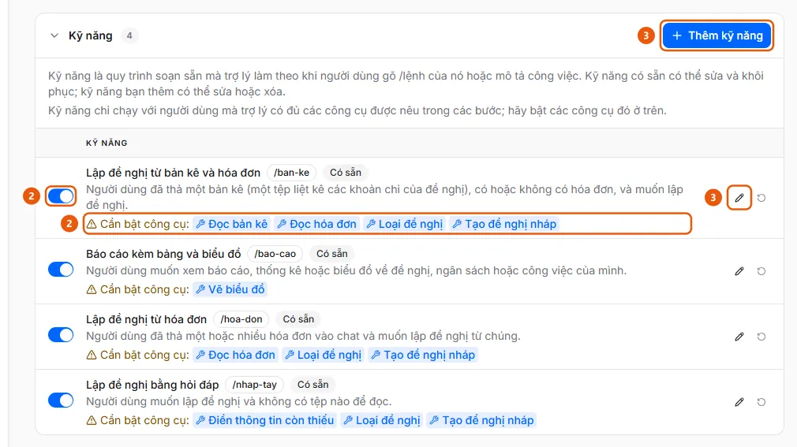

# Manage AI assistant skills

Administrators can add, edit, disable, or restore a skill (a /command) so the assistant follows company procedures.

**When to use:**

- You want the assistant to follow your company’s process for creating requests or reports.
- You want to add a new /command or undo edits to an existing skill.

A skill is a sequence of steps written in natural language that uses enabled tools.

## Ways to do this

- [Add or edit an assistant skill](how-to/manage-assistant-skill.md) — In AI Settings, on the Assistant tab, under Skills, click Add skill or the pencil icon to edit; use the toggle on each row to enable or disable a skill, restore it, or delete it.

## See also

- [Enable the AI assistant and choose what it can do](enable-assistant-tools.md) — Administrators can enable the AI assistant for users and choose which tools (read files, look up information, create drafts, approve, and more) the assistant can use.

## Used in these guides

- [Enable the AI assistant and choose what it can do](enable-assistant-tools.md) — Administrators can enable the AI assistant for users and choose which tools (read files, look up information, create drafts, approve, and more) the assistant can use.

## Steps

[Add or edit an assistant skill](how-to/manage-assistant-skill.md)

1. [Add or edit an assistant skill](how-to/manage-assistant-skill.md)
   1. In the sidebar, under **Administration**, open **AI Settings** (administrators only, on desktop) and select the **Assistant** tab.
   2. Expand **Skills** (the 4 built-in skills are labeled **Available**; each row has an enable/disable toggle (2); if the assistant is missing a tool required by a skill, the row displays "Tools to enable:" (2), followed by the tool name).
      
   3. Click **Add skill** (3) (up to 50 skills per organization), or click the pencil icon (3) in a row to edit. The dialog includes **Name**, **Command** (users type /command in the chat box; lowercase letters, numbers, and hyphens (-) only; must be unique), **When to use**, **Steps** (type @ to insert a tool), and the **Show on welcome screen** toggle.
   4. Click **Save** ("Skill saved.").
   5. To discard edits to a built-in skill (a row labeled **Modified**), click the circular arrow **Restore defaults** icon and confirm; skills added by your organization have a **Delete** button (this action cannot be undone).
   6. Enable the tools required by the skill under **Assistant tools** ([Enable assistant tools](how-to/enable-assistant-tools.md)); the skill runs only for users whose assistant has all of those tools enabled.
