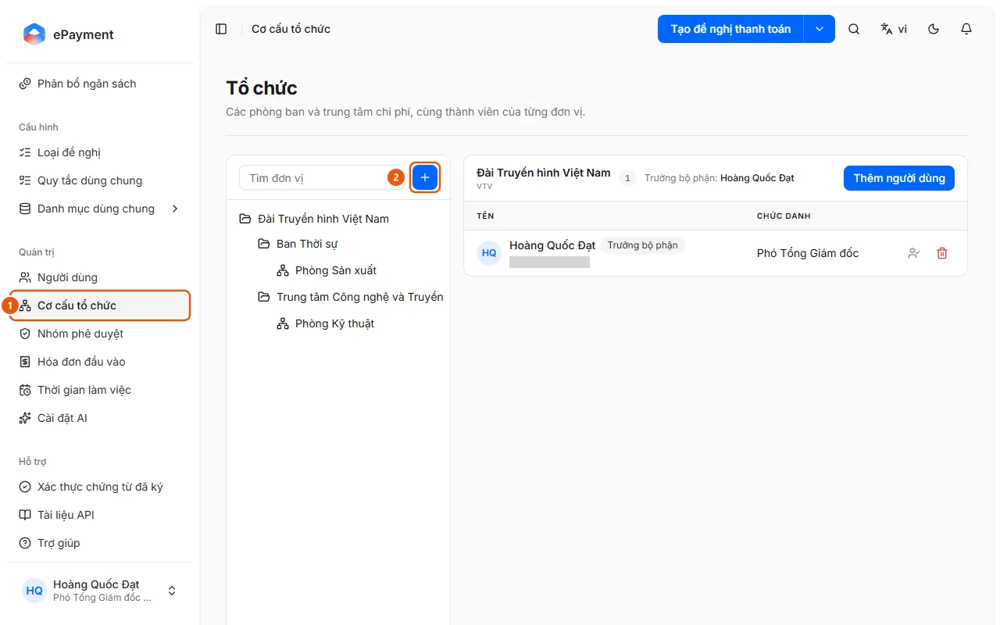

# Edit the organization structure

An administrator wants to add a department, move people between units, or assign a department head.

**When to use:**

- The company creates a new department or changes its department head.
- An administrator wants to reorganize units and members.

The unit structure determines approval flows and the scope for viewing requests.

## Ways to do this

- [Add or edit a unit in the organization structure](how-to/manage-organization.md) — In Organization Structure, click Add unit or Add child unit, then add users and assign a department head.

## Before you start

- **[Cannot delete or disable while in use](../../reference/admin/directory-delete-guards.md)**\
  A unit cannot be deleted if it has child units, members, requests, or allocations; a group cannot be deleted if it has members or is used by a request type.

## Steps

[Add or edit a unit in the organization structure](how-to/manage-organization.md)

1. [Add or edit a unit in the organization structure](how-to/manage-organization.md)
   1. In the sidebar, under **Administration**, open **Organization Structure** (1) (the unit tree on the left with a "Search units" field, and members on the right).
      
   2. Click **Add unit** (the + button, 2), or select **Add child unit** from a unit's **Actions** menu; select **Edit unit** to make changes.
   3. Enter the **Name**, **Code** (use uppercase letters, numbers, hyphens (-), or underscores), and **Description**, then click **Save**.
   4. Select a unit and click **Add user** to add members; use **Set as department head** on a member's row to route approval steps assigned to the department head to that person, or select **Remove from unit**.
   5. Use **Delete unit** when the unit is no longer needed.

## Troubleshooting

### [Add or edit a unit in the organization structure](how-to/manage-organization.md)

- Cannot delete a unit: see [Cannot delete or disable while in use](../../reference/admin/directory-delete-guards.md).
