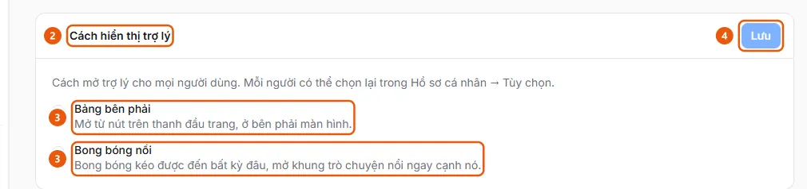

# Set the Default Assistant Opening Mode: Right Panel or Floating Bubble

Administrators can choose how the assistant opens for the entire organization: in the Right Panel or as a draggable Floating Bubble.

**When to use:**

- Administrators want everyone to see the assistant as a Floating Bubble instead of in the Right Panel.
- Administrators want to set how the assistant opens for the entire company.

This is only the default; each user can choose a different option for themselves.

## Ways to do it

- [Set the default assistant display mode](how-to/set-assistant-display.md) — In AI Settings, on the Assistant tab, under Assistant display mode, select Right Panel or Floating Bubble for all users, then click Save.

## See also

- [Choose how the assistant opens for me](../profile/set-assistant-display.md) — Users can choose to open the assistant in the Right Panel or as a Floating Bubble in their browser, overriding the organization default.

## Used in these guides

- [Choose how the assistant opens for me](../profile/set-assistant-display.md) — Users can choose to open the assistant in the Right Panel or as a Floating Bubble in their browser, overriding the organization default.

## Steps

[Set the default assistant display mode](how-to/set-assistant-display.md)

1. [Set the default assistant display mode](how-to/set-assistant-display.md)
   1. In the sidebar, under **Administration**, open **AI Settings** (administrators only, on desktop) and select the **Assistant** tab.
   2. Expand **Assistant display mode** (2).
      
   3. Select **Right Panel** (3) (opens from the button in the top bar) or **Floating Bubble** (3) (a draggable bubble that can be moved anywhere and opens a floating chat panel next to it).
   4. Click **Save** (4). This is the organization default; each user can choose a different option in **Personal Profile** → **Preferences** ([Choose how the assistant opens in Preferences](../profile/how-to/set-assistant-display.md)), and on mobile, the assistant always opens in the **Right Panel**.
