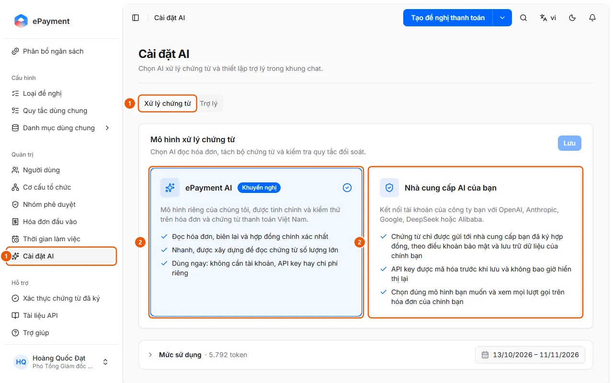

# Choose AI for Invoice Reading and Document Processing

Administrators can choose the AI model used to read invoices, split document packages, and check reconciliation rules: AkaPayment AI or the company's AI account.

**When to use:**

- Your company wants documents sent only to an AI provider it has a contract with.
- Invoice reading or reconciliation fails because a key or custom AI model is no longer available.
- Administrators want invoice reading and reconciliation to use the company's OpenAI, Anthropic, or Gemini account.

This model handles all AI tasks for documents (invoice reading, splitting document packages, and reconciliation); the chat assistant uses a separate model.

## Ways to do this

- [Choose an AI model for document processing](how-to/set-document-model.md) — In AI Settings, on the Document Processing tab, select AkaPayment AI or Your AI Provider (provider, model, and API key), then click Save to validate and apply the settings.

## See also

- [Choose an AI model for the chat assistant](set-assistant-model.md) — Administrators can choose the AI model that responds in the assistant's chat panel and set its reasoning level.

## Used in these guides

- [Choose an AI model for the chat assistant](set-assistant-model.md) — Administrators can choose the AI model that responds in the assistant's chat panel and set its reasoning level.

## Steps

[Choose an AI model for document processing](how-to/set-document-model.md)

1. [Choose an AI model for document processing](how-to/set-document-model.md)
   1. In the sidebar, under **Administration**, open **AI Settings** (administrators only; desktop) and select the **Document Processing** tab (1).
      
   2. On the **Document Processing Model** card, select **AkaPayment AI** (recommended; no key required) or **Your AI Provider** (2).
   3. If you choose your own provider: select a **Provider** (OpenAI, Anthropic, Google Gemini, DeepSeek, Alibaba Qwen), select or enter a model ID in the **Model** field (the model must be able to read images), and enter an **API key**; use **Advanced** → **Base URL** only for OpenAI-compatible servers or proxies.
   4. Click **Save**. For your own provider, the page displays "Validating… This may take a minute or two."; after validation succeeds, the model is applied ("Model applied.").

## Notes

- **[When your organization uses its own AI model](../../reference/ai/own-model.md)**\
  A custom model must pass validation before it is applied; the key is not shown again. If the provider fails, AI features stop and do not automatically switch to AkaPayment AI.

## Troubleshooting

### [Choose an AI model for document processing](how-to/set-document-model.md)

- "… did not pass validation. The current model is still in use.": Check the reason listed for each item under **Connection**, **Image reading**, and **Structured response** (or **Validation** if validation did not complete), fix the key, model ID, or Base URL, then click **Save** again (you do not need to re-enter the key). See [When your organization uses its own AI model](../../reference/ai/own-model.md).
