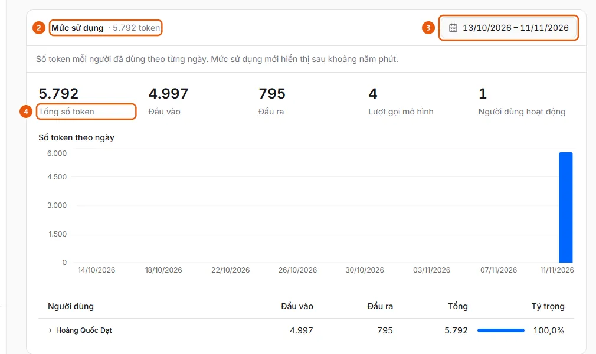

# View AI token usage by user

Administrators can view AI token usage by day and user for document processing and the assistant.

**When to use:**

- AI costs are increasing, and administrators want to know who is using the most tokens.
- Administrators want to view the daily token total for document processing or the assistant.

Each tab in AI Settings has its own Usage section. The data may take about 5 minutes to update.

## Ways to do this

- [View AI token usage](how-to/view-ai-usage.md) — In AI Settings, open the Usage section at the bottom of the Document Processing or Assistant tab, select a date range, and view token usage by day and user.

## Steps

[View AI token usage](how-to/view-ai-usage.md)

1. [View AI token usage](how-to/view-ai-usage.md)
   1. In the sidebar, under **Administration**, open **AI Settings** (administrators only, on desktop). Select the **Document Processing** tab (read invoices, split documents, reconcile) or the **Assistant** tab (chat window).
   2. Scroll to the bottom of the tab and open the **Usage** section (2). Its heading shows the total tokens for the selected date range.
      
   3. Select a date range in the date field (3) at the top of the section (the default is the last 30 days; dates use your organization's time zone).
   4. View **Total Tokens** (4), **Input**, **Output**, **Model Calls**, **Active Users**, the daily token usage chart, and the table by **User** with **Share**. Click the arrow on a row to view that user's daily usage.

## Troubleshooting

### [View AI token usage](how-to/view-ai-usage.md)

- Recent usage is not shown yet: new usage appears after about five minutes. The **Other** row groups usage that could not be associated with an AkaPayment user.
- Date ranges longer than 366 days are rejected: select a shorter range.
