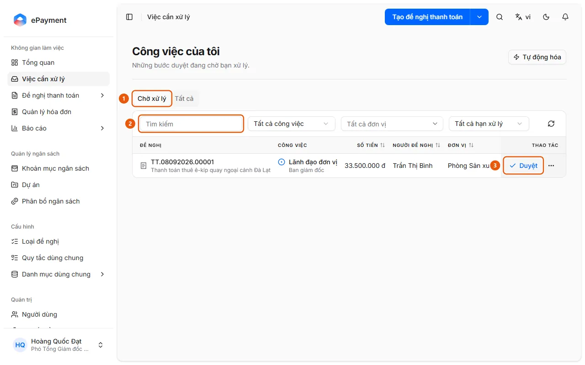
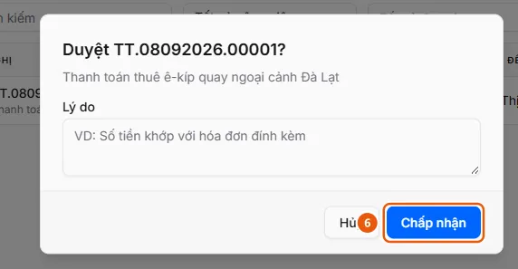

# Approve a Request Assigned to Me

The approver handles a task assigned to them in Tasks to Do.

**When to use:**

- The user sees the notification "A request needs my approval" and wants to approve it.
- The user has a pending approval step and wants to approve it.

You have an approval step assigned to you and want to approve the request.

## Ways to do this

- [Approve an assigned task](how-to/approve-task.md) — Open Tasks to Do and click Approve on the row, or open the request and click Approve on the Your Tasks card; for steps that require a signature, sign with your signing password.

## Used in guides

- [AkaPayment](../../index.md) — Create, approve, and track payment requests; receive incoming invoices, reconcile supporting documents, and manage budgets with an AI assistant.

## Before you begin

- **[Rules for approving, rejecting, returning, and delegating](../../reference/approvals/action-rules.md)**\
  Returning requires a reason; delegating requires selecting another recipient; rejecting does not require a reason; approval may require a signature.

## Steps

[Approve an assigned task](how-to/approve-task.md)

1. [Approve an assigned task](how-to/approve-task.md)
   1. Open **Tasks to Do** in the sidebar; the "My Tasks" page opens on the **Pending** tab (1).
      
   2. Find the task using the **Search** field (2) or, if needed, the **All Tasks**, **All Units**, and **All Due Dates** filters.
   3. Click **Approve** (3) at the end of the row, or click the request to open its details page and then click **Approve** on the "Your Tasks" card (in the list, a confirmation dialog asks "Approve {code}?").
   4. If the step has required custom fields, fill them in first (the Approve button remains disabled until all required fields are filled in). If the step allows budget allocation adjustments and you need to change a line item or cost center, follow [Adjust budget allocation during approval](how-to/adjust-allocation.md) before approving.
   5. If the **Sign Approval** dialog appears, enter your **Signing Password** (and **Reason** if required), then click **Sign and Approve**. If you see the message "Please complete your signing profile first.", click **Go to Profile** to set up your signature, then return.
   6. If no signing dialog appears, confirm the approval in the dialog (the **Reason** field is optional): click **Accept** (6) in the dialog opened from the list, or **Confirm** on the details page.
      
   Optional: [Signature and signing password are set up](../../troubleshooting/profile/signing-ready.md) — In Personal Profile → the "Signature" tab, the signature image and the text "Signing password set." are displayed. If this is not set up, consider [Setting a signature and signing password in your profile](../profile/how-to/set-signature.md).

## Troubleshooting

### [Approve an assigned task](how-to/approve-task.md)

- If a reason is required, delegation is needed, or signing is blocked, see [Rules for approving, rejecting, returning, and delegating](../../reference/approvals/action-rules.md).
- To return or reject a request, or delegate the task instead of approving it, see [Return a request to its creator](how-to/return-request.md), [Reject a request](how-to/reject-request.md), [Delegate a task to someone else](how-to/delegate-task.md).
