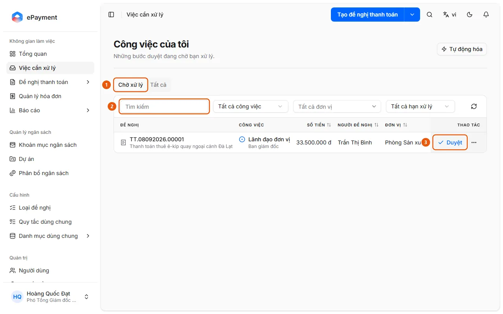
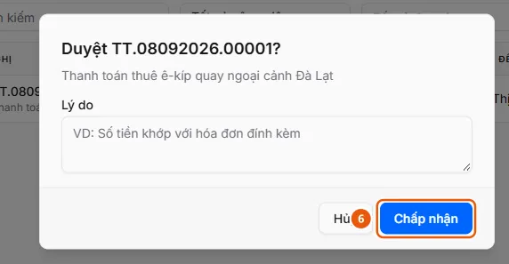

# Approve an Assigned Task

Open Tasks to Process and click Approve on the row, or open the request and click Approve on the Your Tasks card. For steps that require a signature, sign with your signing password.

## Before you start

- **[Rules for approving, rejecting, returning, and delegating](../../../reference/approvals/action-rules.md)**\
  Returning a request requires a reason; delegating requires selecting a different recipient; rejecting does not require a reason; approval may require a signature.

## Steps

1. Open **Tasks to Process** in the sidebar. The "My Tasks" page opens on the **Pending** tab (1).

   

2. Find the task using the **Search** box (2), or use the **All Tasks**, **All Departments**, and **All Due Dates** filters if needed.
3. Click **Approve** (3) at the end of the row, or click the request to open its details page and then click **Approve** on the "Your Tasks" card (in the list, a dialog asks "Approve {code}? ").
4. If the step has required custom fields, fill them in first (the Approve button stays disabled until all required fields are filled in). If the step allows budget allocation adjustments and you need to change a line item or cost center, follow [Adjust the budget allocation when approving](adjust-allocation.md) before approving.
5. If the **Sign Approval** dialog appears, enter your **Signing Password** (and **Reason** if required), then click **Sign and Approve**. If you see "Complete your signing profile first.", click **Go to Profile** to set up your signature, then return.
6. If no signing dialog appears, confirm the approval in the dialog (**Reason** is optional): click **Accept** (6) in the dialog opened from the list, or **Confirm** on the details page.

   

## Troubleshooting

- If a reason is required, delegation is needed, or signing is locked, see [Rules for approving, rejecting, returning, and delegating](../../../reference/approvals/action-rules.md).
- To return or reject the request, or delegate the task instead of approving it, see [Return a request to its creator](return-request.md), [Reject a request](reject-request.md), and [Delegate a task to someone else](delegate-task.md).

## Optional setup

- [Set up your signature and signing password](../../../troubleshooting/profile/signing-ready.md) — Your profile must have a signature image and signing password for approval steps that require a signature.

## Used in these guides

- [Rules for approving, rejecting, returning, and delegating](../../../reference/approvals/action-rules.md) — Returning a request requires a reason; delegating requires selecting a different recipient; rejecting does not require a reason; approval may require a signature.
- [Approve a task assigned to me](../approve-task.md) — Approvers handle a task waiting for them in Tasks to Process.
- [Adjust the budget allocation when approving](adjust-allocation.md) — In a request awaiting your approval, open an expense line in the Expense Report, click Edit Allocation, change the line item, department, or project, then click Save.
