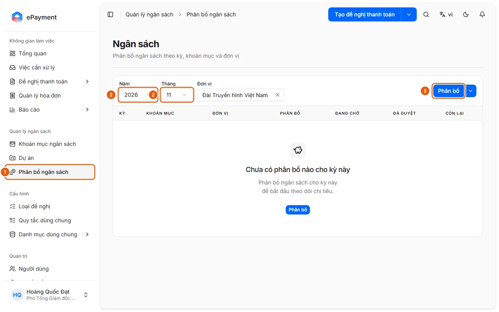
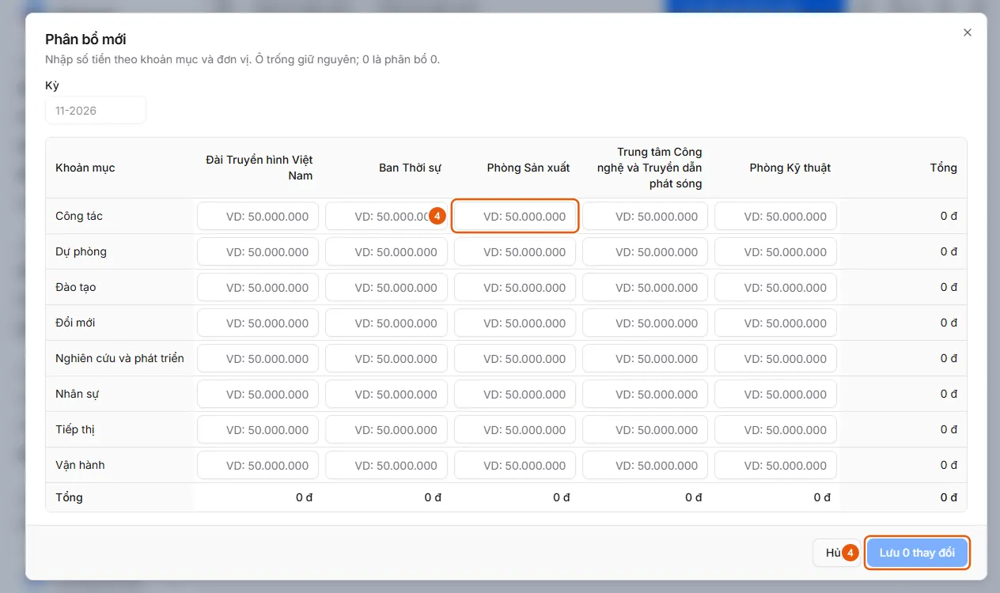

# Budget Allocation

Budget managers want to set limits by period, category, and entity (and project when project-based allocation is enabled).

**When to use:**

- At the start of a period, you need to set budgets for categories.
- Budget managers want to allocate amounts for a period.

Limits are the basis for the request's Remaining amount and Budget Check.

## How to

- [Allocate a budget for a period](how-to/allocate.md) — In Budget Management → Budget Allocation, select the year, month, entity (and project), then click Allocate to enter amounts by category and entity.

## Used in guides

- [AkaPayment](../../overview.md) — Create, approve, and track payment requests; receive incoming invoices, reconcile documents, and manage budgets with an AI assistant.

## Before you start

- **[Budget allocation entry rules](../../reference/budget/allocation-rules.md)**\
  Amounts must be non-negative; each combination can appear only once per batch; a batch can contain up to 5000 rows; notes can contain up to 1024 characters.

## Steps

[Allocate a budget for a period](how-to/allocate.md)

1. [Allocate a budget for a period](how-to/allocate.md)
   1. In the sidebar, under **Budget Management**, open **Budget Allocation** (1) (the "Budget" page; operators and administrators only, desktop only).
      
   2. Select **Year**, **Month** (2), **Entity**, and **Project** if the budget is allocated by project.
   3. Click **Allocate** (3) to open the "New Allocation" table for the selected period: rows are categories, columns are entities; leave a cell blank to keep its value unchanged; enter 0 to allocate zero. For project-based allocation, select **Project** first ("Select a project to get started.").
   4. Enter the amounts (4), then click **Save N changes** (4) (or **Cancel**).
      
   5. To edit or delete an existing row, use **Edit Allocation** or **Delete Allocation** on the row (deletion cannot be undone).
   6. To enable or disable project-based allocation, click the arrow next to **Allocate** → **Budget Allocation Dimensions** (Budget Category and Entity are always enabled). To enter multiple rows using Excel, see [Import budget allocations from Excel](how-to/import-allocations.md).

## Troubleshooting

### [Allocate a budget for a period](how-to/allocate.md)

- For negative amounts, duplicate combinations, or a missing project, see [Budget allocation entry rules](../../reference/budget/allocation-rules.md). If there are no categories or projects ("There are no active budget categories."): add them in [Add or edit a master data record](../master-data/how-to/manage-list.md).
