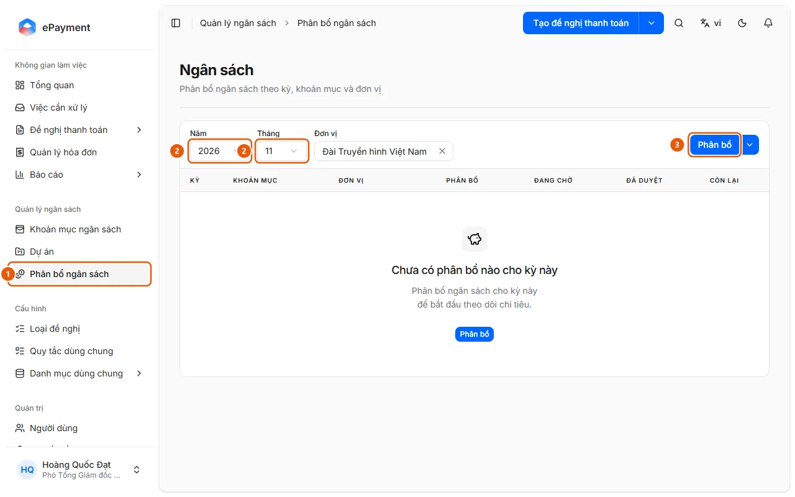
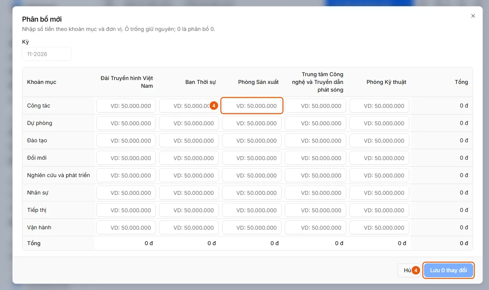

# Allocate a budget for a period

In Budget Management → Budget Allocation, select the year, month, and unit (and project), then click Allocate to enter amounts by budget item and unit.

## Before you begin

- **[Budget allocation entry rules](../../../reference/budget/allocation-rules.md)**\
  Amounts must be non-negative; each combination can appear only once in a batch; a batch can contain up to 5,000 rows; notes can contain up to 1,024 characters.

## Steps

1. In the sidebar, under **Budget Management**, open **Budget Allocation** (1) (the "Budget" page; available to operators and administrators on desktop only).

   

2. Select **Year**, **Month** (2), **Unit**, and **Project** if the budget is allocated by project.
3. Click **Allocate** (3) to open the "New allocation" table for the selected period: rows represent budget items, and columns represent units. Leave a cell blank to keep its value unchanged; enter 0 to allocate zero. For project-based allocation, select **Project** first ("Select a project to get started.").
4. Enter the amounts (4), then click **Save N changes** (4) (or **Cancel**).

   

5. To edit or delete an existing row, use **Edit allocation** or **Delete allocation** on that row (deletion cannot be undone).
6. To enable or disable project-based allocation, click the arrow next to **Allocate** → **Budget allocation dimensions** (Budget Item and Unit are always enabled). To enter multiple rows using Excel, see [Import budget allocations from Excel](import-allocations.md).

## Troubleshooting

- For negative amounts, duplicate combinations, or a missing project, see [Budget allocation entry rules](../../../reference/budget/allocation-rules.md). If there are no budget items or projects ("There are no active budget items."): add them in [Add or edit a list record](../../master-data/how-to/manage-list.md).

## Used in these guides

- [Allocate a budget](../allocate.md) — For budget managers who want to set limits by period, budget item, and unit (and by project when project-based allocation is enabled).
- [Open the monthly budget plan report](../../reports/how-to/review-plan-monthly.md) — Open Reports → Monthly Budget Plan in the sidebar, select a year, and review the allocated amounts for each month by unit or budget item.
