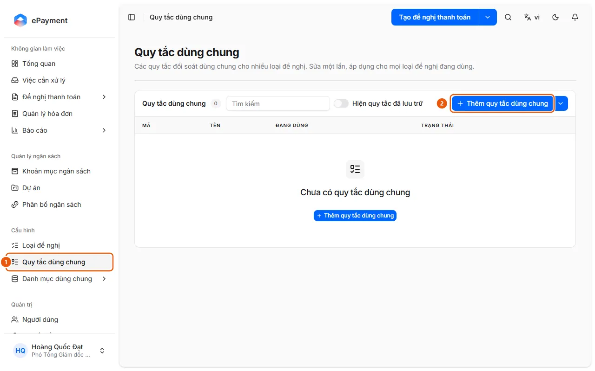
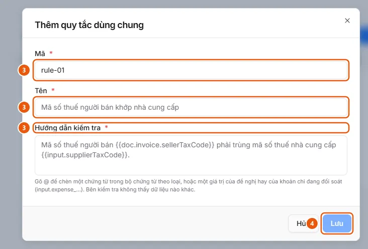

# Create and edit shared reconciliation rules

Settings → Shared rules: Add a shared rule (Code, Name, Check instructions), edit, archive, or restore it; link it to a request type in the Request workflow tab.

## Before you begin

* **[Shared rule saving requirements](../../../reference/config/global-rule-rules.md)**\
  The code must be 1–32 characters (letters, numbers, \_ . -) and cannot be changed after creation; codes and names must be unique; check instructions must use valid variables; edits apply immediately to all linked request types.

## Steps

1. In the sidebar, under **Settings**, open **Shared rules** (1) (available to operators and administrators on desktop only; the table shows Code, Name, In use = number of request types, and Status; search using the **Search** field, and turn on **Show archived rules** to include archived rules).

   
2. Click **Add shared rule** (2), or click **Edit shared rule** in a rule's row.
3. Enter **Code** (only when creating a rule; a suggestion is provided), **Name**, and **Check instructions** (3). Type `@` in the instructions field to insert a variable from a document or request (for example, "The seller's tax code `{{doc.invoice.sellerTaxCode}}` must match the supplier's tax code `{{input.supplierTaxCode}}`.").

   
4. Click **Save** (4). If the rule is in use, a dialog lists the affected request types; click **Save and apply**.
5. To stop using a rule, click **Archive** in its row (you'll be asked to confirm if the rule is in use); click **Restore** to use it again. The menu next to **Add shared rule** contains **Export JSON** and **Import JSON** for transferring rules between environments.
6. To use a rule in a request type: open the type in [Set up and publish a request type](publish-request-type.md) → **Request workflow** tab → Expense report step → **Reconciliation** section (turn on **Enable reconciliation** if it's not already enabled) → **Add shared rule**; select the rule, click **Add N rules**, then publish. You can move an individual rule to the Shared rules list by clicking **Convert to shared**.

## Troubleshooting

* Saving is rejected (duplicate code or name, invalid variable, or another user has just edited the rule): see [Shared rule saving requirements](../../../reference/config/global-rule-rules.md).

## Used in these guides

* [Manage shared reconciliation rules](../manage-reconciliation-rule.md) — For administrators who want to create or edit a document reconciliation rule once and use it across multiple request types.
* [Set up and publish a request type](publish-request-type.md) — Open a request type, edit the tabs, click Save, then Publish; if publishing fails, a list of issues to fix is shown.
