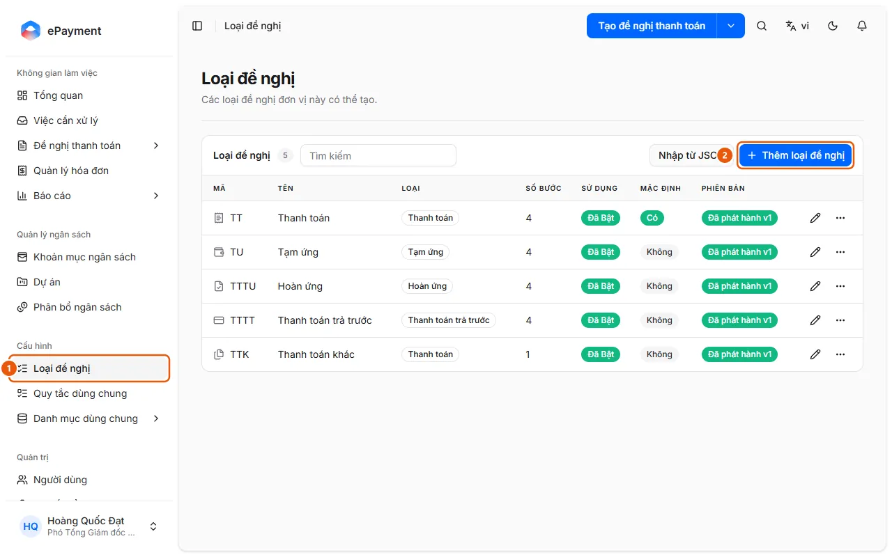
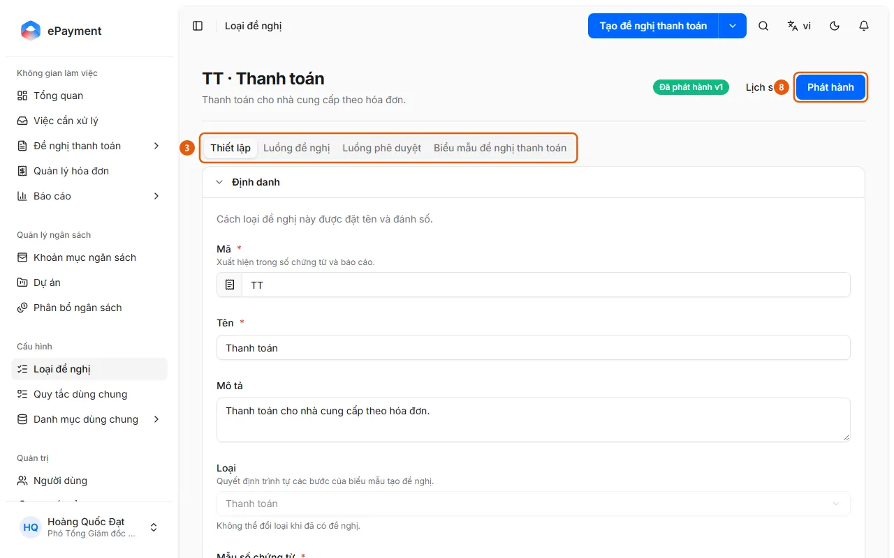

# Configure and publish a request type

Open a request type, edit its tabs, and click Save and then Publish. If publishing fails, a list of issues to fix is displayed.

## Before you begin

- **[Request type publishing requirements](../../../reference/config/publish-validation.md)**\
  If publishing fails, a list of issues is shown by tab (Settings, Request Flow, Approval Flow). Publishing a request type with no changes does not create a new version.

## Steps

1. In the sidebar, under **Configuration**, open **Request Types** (1).

   

2. Click a request type to edit it, or click **Add Request Type** (2) (or **Import from JSON**) to create one; click **Duplicate** to copy an existing request type.
3. In the **Settings** tab (tab bar, 3), edit Identity (Code and Name are required), Usage Scope, and Behavior (payment method, payee, Budget Check, Require Approval Signature, Completion Commitment, and the Excel Expense Breakdown template). The **Type** field cannot be changed after a request has been created for the request type ("The type cannot be changed after a request has been created.").

   

4. In the **Request Flow** tab (tab bar, 3), open each requester step (Overview, Expense Breakdown, Payment, Review) to edit it. The Expense Breakdown step has field groups, a "Required Documents" section (each document type has a **Required** checkbox; documents required by a reconciliation rule are always required), and a **Reconciliation** section with the **Enable Reconciliation** toggle, **Add Rule**, **Add Shared Rule**, and **Copy from Request Type** buttons (shared rules: [Create and edit shared reconciliation rules](manage-reconciliation-rule.md)).
5. In the **Approval Flow** tab (tab bar, 3), arrange the steps (each step is assigned to an approval group and must have a name); you can also click **Copy from…** to copy from another request type. Under **Advanced Settings** for a step, enable **Skip when the approver is the requester** or **Adjust Budget Allocation** (the approver for that step can edit the allocation; see [Adjust budget allocation during approval](../../approvals/how-to/adjust-allocation.md)).
6. In the **Payment Request Form** tab (tab bar, 3), design the printed form. This tab has its own **Save** button for the layout.
7. Click **Save** at the top of the page to save your current edits as a draft (the page displays "Unpublished changes" when the draft differs from the published version). **Discard Changes** reverts the request type to its latest published version and cannot be undone.
8. Click **Publish** (8) and confirm "Publish this request type?": the draft becomes the version used for new requests, while in-progress requests continue using the previous version. On success, "Published vN." is displayed. Otherwise, "Unable to publish this request type." appears with a list of issues, each identifying the tab that needs to be fixed.

## Troubleshooting

- Publishing is rejected: see [Request type publishing requirements](../../../reference/config/publish-validation.md); no version is saved. To revert to an older version, see [Restore a request type version](restore-request-type.md).

## Used in these guides

- [Configure and publish a request type](../publish-request-type.md) — For administrators who want to create or change a request type and make it available for use.
- [Add or edit an approval group](../../admin/how-to/manage-approval-group.md) — In Approval Groups, click Add Approval Group, then add or remove members.
- [Adjust budget allocation during approval](../../approvals/how-to/adjust-allocation.md) — In a request awaiting your approval, open an expense row in Expense Breakdown, click Edit Allocation, change the account, department, or project, and then click Save.
- [Create and edit shared reconciliation rules](manage-reconciliation-rule.md) — Go to Configuration → Shared Rules: click Add Shared Rule (Code, Name, Validation Instructions), Edit, Archive, or Restore; link the rule to a request type in the Request Flow tab.
