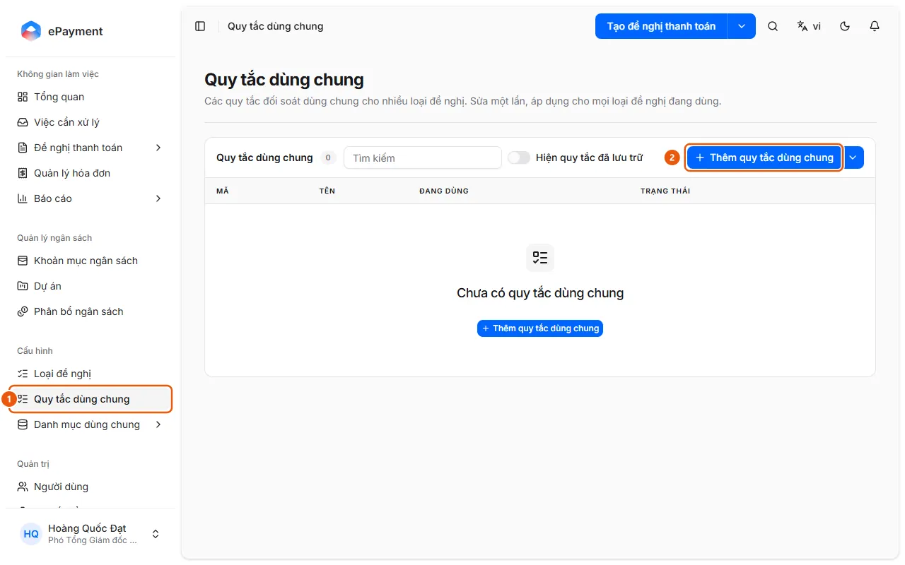
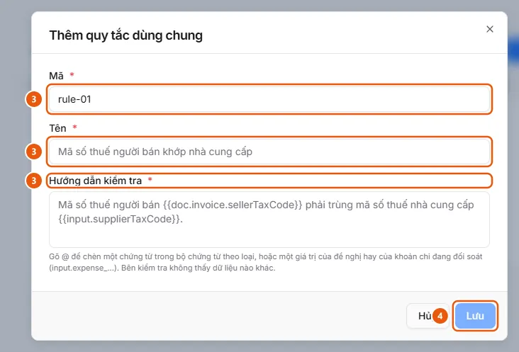

# Manage Shared Reconciliation Rules

Administrators can create or edit a document reconciliation rule once and use it across multiple request types.

**When to use:**

* You want to change how documents are checked for all request types at once.
* You want to reuse a reconciliation rule across multiple request types.

Shared rules are stored in a library: edit a rule once to apply the change to every linked request type.

## How to

* [Create and edit shared reconciliation rules](how-to/manage-reconciliation-rule.md) — Configuration → Shared Rules: Add a shared rule (Code, Name, Check Instructions), Edit, Archive, or Restore it; link it to a request type in the Request Flow tab.

## Before you start

* **[Shared rule save requirements](../../reference/config/global-rule-rules.md)**\
  Codes must be 1–32 characters (letters, numbers, \_ . -) and cannot be changed after creation; codes and names must be unique; instructions must use valid variables; edits take effect immediately for all linked request types.

## Steps

[Create and edit shared reconciliation rules](how-to/manage-reconciliation-rule.md)

1. [Create and edit shared reconciliation rules](how-to/manage-reconciliation-rule.md)
   1. In the sidebar, under **Configuration**, open **Shared Rules** (1) (available only to operators and administrators, on desktop only; the table shows Code, Name, In Use = number of request types, and Status; search using the **Search** field, or turn on **Show archived rules** to include archived rules).
      
   2. Click **Add shared rule** (2), or click **Edit shared rule** in a rule's row.
   3. Enter the **Code** (only when creating a rule; a suggestion is provided), **Name**, and **Check Instructions** (3); type `@` in the instructions field to insert a document or request variable (for example, "The seller's tax code `{{doc.invoice.sellerTaxCode}}` must match the supplier tax code `{{input.supplierTaxCode}}`.").\
      
   4. Click **Save** (4). If the rule is in use, a dialog lists the affected request types; click **Save and apply**.
   5. To stop using a rule, click **Archive** in its row (you'll be asked to confirm if the rule is in use); click **Restore** to use it again. The menu next to **Add shared rule** contains **Export JSON** and **Import JSON** for transferring rules between environments.
   6. To use a rule for a request type: open the request type in [Configure and publish a request type](how-to/publish-request-type.md) → the **Request Flow** tab → the Expense Report step → **Reconciliation** section (turn on **Enable reconciliation** if it is not already enabled) → **Add shared rules**, select a rule, click **Add N rules**, then publish. You can move an individual rule to the Shared Rules list using **Convert to shared**.

## Troubleshooting

### [Create and edit shared reconciliation rules](how-to/manage-reconciliation-rule.md)

* Save is rejected (duplicate code or name, invalid variable, or someone else edited the rule): see [Shared rule save requirements](../../reference/config/global-rule-rules.md).
