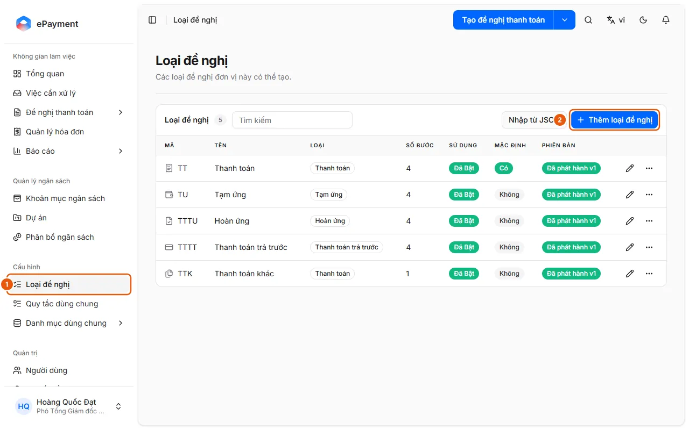
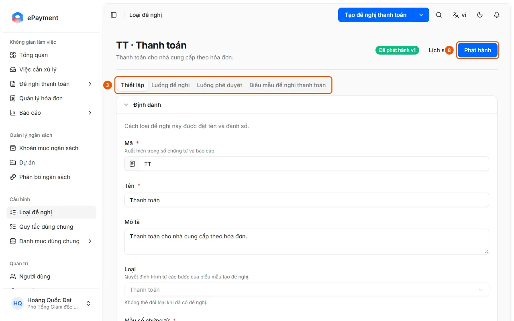

# Configure and publish a request type

Administrators can create or update a request type and make it available for use.

**When to use:**

- An administrator wants to change the approval flow for a request type.
- An administrator wants to create or update a request type.

Set the name, approval flow, and behavior of the request type, then publish a new version.

## How to

- [Configure and publish a request type](how-to/publish-request-type.md) — Open the request type, edit its tabs, click Save, then Publish. If publishing fails, a list of issues to fix is displayed.

## Before you begin

- **[Request type publishing requirements](../../reference/config/publish-validation.md)**\
  If publishing fails, issues are listed by tab (Settings, Request Flow, Approval Flow). Publishing a request type with no changes does not create a new version.

## Steps

[Configure and publish a request type](how-to/publish-request-type.md)

1. [Configure and publish a request type](how-to/publish-request-type.md)
   1. In the sidebar, under **Configuration**, open **Request Types** (1).
      
   2. Click a request type to edit it, or click **Add Request Type** (2) (or **Import from JSON**) to create one; click **Duplicate** to copy an existing type.
   3. On the **Settings** tab (tab bar, 3), edit Identity (Code and Name are required), Usage Scope, and Behavior (payment method, beneficiary, Budget Check, Require Approval Signature, Completion Commitment, and the Excel Expense Breakdown template). The **Type** field cannot be changed once the request type has requests ("Type cannot be changed once requests exist.").
      
   4. On the **Request Flow** tab (tab bar, 3), expand each requester step (Overview, Expense Breakdown, Payment, Review) to edit it. The Expense Breakdown step has field groups, a "Required Documents" section (each document type has a **Required** checkbox; a document required by a reconciliation rule is always required), and a **Reconciliation** section with the **Enable Reconciliation** toggle, **Add Rule**, **Add Shared Rule**, and **Copy from Request Type** buttons (shared rules: [Create and edit shared reconciliation rules](how-to/manage-reconciliation-rule.md)).
   5. On the **Approval Flow** tab (tab bar, 3), arrange the steps (each step is assigned to an approval group and must have a name); you can also click **Copy from…** to copy from another type. Under **Advanced Settings** for a step, enable **Skip if approver is the requester** or **Adjust budget allocation** (the approver for that step can edit the allocation; see [Adjust budget allocation during approval](../approvals/how-to/adjust-allocation.md)).
   6. On the **Payment Request Form** tab (tab bar, 3), design the printed form; this tab has its own **Save** button for the layout.
   7. Click **Save** at the top of the page to save your pending edits (the page displays "There are unpublished changes" when the draft differs from the published version). **Discard Changes** reverts the request type to the most recently published version and cannot be undone.
   8. Click **Publish** (8) and confirm "Publish this request type?": the draft becomes the version used for newly created requests, while requests already in progress keep the old version. On success, "Published vN." is displayed; otherwise, "Cannot publish this request type." is displayed with a list of issues, each specifying the tab to fix.

## Troubleshooting

### [Configure and publish a request type](how-to/publish-request-type.md)

- Publishing was rejected: see [Request type publishing requirements](../../reference/config/publish-validation.md); no version was saved. To revert to an older version, see [Restore a request type version](how-to/restore-request-type.md).
