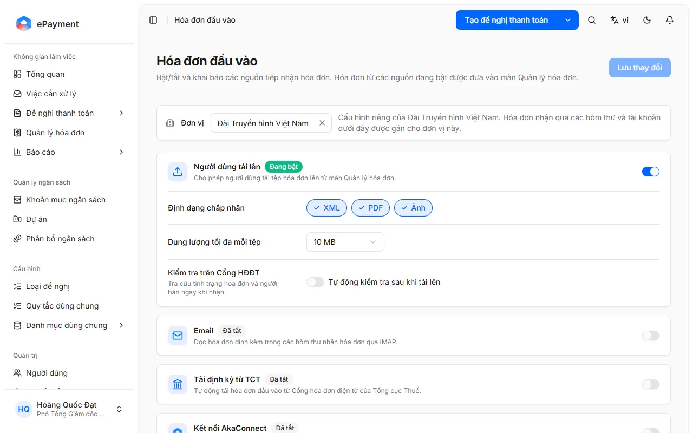

# Manage Invoice Sources

Administration → Incoming Invoices: enable or disable sources, configure mailboxes and e-invoice portal accounts, and connect AkaConnect and AkaPay. Administrators only.

**Required permission:** admin

There are 5 sources: **User upload**, **Email** (IMAP), **Scheduled download from GDT** (scheduled downloads from the General Department of Taxation's e-invoice portal), **AkaConnect connection** (Gmail, Outlook), and **AkaPay account**. Invoices from enabled sources appear on the Invoice Management page. For the Email source, the page can save a mailbox and check the IMAP connection, but reading messages and adding invoices to the list is not yet supported (see [Receive invoices via an email mailbox (IMAP)](../connect-mailbox.md)).

Only administrators (and organization owners) can open the page (**Administration** → **Incoming Invoices**) and save settings; other users cannot open the page or save settings (403 error). The page is available on desktop only and cannot be opened on a phone. Operators cannot access this page, but they can click **Sync now** on a source card in Invoice Management.

## Notes

- **[Invoice source settings: organization-wide or per unit](../../../reference/invoice-sources/unit-scope.md)**\
  Enablement, formats, file size, and Validate on e-Invoice Portal settings apply to the entire organization; frequency, download schedule, and source accounts are configured separately for each unit.

## Used in these guides

- [Enable or disable invoice sources and save settings](../how-to/configure.md) — Go to Administration → Incoming Invoices, select a unit scope, enable or disable each source, configure formats, file size, validation on the e-Invoice Portal, and frequency, then click Save changes.
- [Connect a Gmail/Outlook mailbox via AkaConnect](../how-to/connect-akaconnect.md) — Enable AkaConnect connection, select a unit, click Add connection, and complete the Gmail or Outlook mailbox connection in the AkaConnect pop-up window.
- [Connect an AkaPay account with an API key](../how-to/connect-akapay.md) — Enable AkaPay account, click Add account, paste the API key, click Load pipeline, select a pipeline and the invoice statuses to receive, enter a name, then click Add.
- [Add an email mailbox to receive invoices via IMAP](../how-to/connect-mailbox.md) — Select a unit, click Add mailbox on the Email card, enter the address, choose a sign-in method (app password or OAuth), click Test connection, then click Add.
- [Download invoices on a schedule from the General Department of Taxation e-invoice portal](../how-to/connect-tax-portal.md) — Enable Scheduled download from GDT, set the download schedule, scope, invoice type, and template symbol; add the unit's e-invoice portal account, click Test connection, then click Add.
- [Sign in to a mailbox with OAuth (Microsoft 365, Google, other servers)](../how-to/mailbox-oauth.md) — Select OAuth - Microsoft 365, OAuth - Google, or OAuth - other identity server, follow the Setup steps, and enter the Client ID and Client secret. For Google, click Sign in with Google.
- [Sign in to a mailbox with an app password](../how-to/mailbox-password.md) — In the Add mailbox dialog, select Sign-in method: App password, then enter the IMAP server, port, username, and app password.
